# PRODUCT REQUIREMENTS DOCUMENT (PRD)
# SISTEM MANAJEMEN KINERJA & KEY PERFORMANCE INDICATOR (KPI) PERBANKAN

**Organisasi:** PT BPR BKK JATENG (Perseroda)  
**Versi:** 2.3 Rev.2 — Desain rinci workflow, hak akses dan aturan bisnis Direksi / Working Draft  
**Tanggal:** 13 November 2026  
**Status:** DRAFT PENAJAMAN ATURAN BISNIS — BELUM DISETUJUI MANAJEMEN  
**Platform:** Web responsif (desktop dan mobile)  
**Teknologi acuan:** Laravel/PHP, MySQL, integrasi SIMPEG dan sumber data bisnis (mengikuti PRD v1.0)  
**Pemilik keputusan:** Manajemen, SDM/HC, Divisi Bisnis, Divisi Operasional, TI, dan pemilik data terkait  
**Dokumen dasar:** `PRD_Sistem_KPI.md` versi 1.0 tanggal 12 November 2026.

> **Status ketentuan:** Ketentuan yang dinyatakan berasal dari PRD v1.0 dipertahankan sebagai baseline rancangan, BUKAN otomatis sebagai kebijakan direksi. Usulan desain baru diberi label **[USULAN]**. Hal yang belum disahkan diberi label **[KEPUTUSAN]**. Tiga keputusan desain (seluruh pegawai termasuk pejabat struktural; periode tiga bulan; KPI bisnis individu dan cabang) berasal dari pengusul. Bobot, predikat, kalender dan jadwal penilaian, pemilik indikator, approver struktural, dan SLA tetap memerlukan pengesahan manajemen.

## A. Ringkasan eksekutif

Sistem KPI adalah aplikasi terintegrasi untuk penetapan indikator dan target, pengumpulan bukti kinerja, penarikan realisasi bisnis otomatis, penilaian mandiri pegawai, review berjenjang, justifikasi, finalisasi, monitoring, dan pelaporan kinerja yang dapat diaudit. Integrasi organisasi menggunakan SIMPEG sebagai sumber master pegawai/jabatan/kantor; data kuantitatif tetap bersumber dari sistem bisnis yang ditetapkan sebagai *source of truth*.

**Alur baseline tahap pertama:**

- **Kantor Cabang (KC):** pegawai → Kabid bidang yang relevan → Kepala Cabang (Kacab). Contoh: Teller → Kabid Operasional → Kacab; AO Kredit → Kabid Pemasaran → Kacab.
- **Kantor Kas (KK):** mengikuti cabang induk dan penilai yang ditentukan konfigurasi, bukan workflow terpisah secara otomatis.
- **Kantor Wilayah (KW):** pegawai → Koordinator Wilayah (Korwil).
- **Kantor Pusat (KP):** staf divisi → Kabid → Kepala Divisi (Kadiv).
- **Kebijakan masih terbuka:** seluruh pejabat struktural kini menjadi subjek KPI, tetapi reviewer akhir Kacab, Korwil, Kadiv belum disahkan; otomatisasi gaji/insentif, promosi, dan 360-degree review tetap di luar cakupan.

### A.1 Perubahan utama dibanding PRD v1.0

| Area | Baseline v1.0 | Pendalaman v2.0 |
|---|---|---|
| Hierarki | Parent jabatan + konfigurasi | Resolver penilai, *acting/delegation*, anomali, dan pembekuan snapshot |
| Indikator | Kuantitatif/kualitatif | Versi definisi, orientasi, granularity, kepemilikan dan sumber target terpisah |
| Data bisnis | Source mapping, sync log | Data contract, staging, rekonsiliasi, quality gate, cut-off dan lineage |
| Penilaian | Header/detail dan approval | Mesin state, langkah aktif, revision history, penolakan, finalisasi dan koreksi |
| Nilai | Formula konseptual | Formula terversi, aturan nol/null, skala, cap/floor, simulasi dan explainability |
| Database | Tabel konseptual | Model relasional terkelompok, constraint, indeks, snapshot, log dan outbox |
| Pengawasan | Dashboard dan laporan | KPI keterlambatan proses, kualitas data, audit, akses berdasarkan lingkup |
| Implementasi | Tahapan umum | Prasyarat keputusan, API, matriks UAT, kriteria go-live, cut-over dan rollback |

### A.2 Keputusan desain yang dikonfirmasi pada 13 November 2026

| Kode | Kesepakatan pengusul | Implikasi untuk desain |
|---|---|---|
| DEC-01 | Seluruh pegawai termasuk pejabat struktural | Semua pejabat sebagai peserta, tanpa self-approval; reviewer atas Kacab/Korwil/Kadiv masih pending |
| DEC-02 | Periode tiga bulan | Penilaian per triwulan, dengan jendela pengukuran dipisah dari penilaian dan cut-off; kalender tepatnya pending |
| DEC-03 | KPI bisnis individu dan cabang/unit | Template per jabatan memakai sumber dan level atribusi yang terpisah; bobot/share vs allocation belum diputuskan |

Keputusan ini memperbarui ruang lingkup peserta pada bagian v2.0. Ketentuan lama yang menyebut pejabat struktural tidak dinilai tidak lagi dipakai sebagai aturan eligibility. Jalur approval Kacab, Korwil, dan Kadiv telah dikonfirmasi pengusul pada v2.3; pemetaan direktorat, pejabat sah, dan mandat kekosongan tetap menunggu validasi.


### A.3 Pembaruan keputusan v2.3 (13 November 2026)

- **DEC-04:** Kacab dinilai Korwil lalu disetujui Direktur sesuai bidang.
- **DEC-05:** Korwil dan Kadiv dinilai sekaligus difinalisasi Direktur sesuai bidang, satu step Direksi.
- **DEC-06:** Posisi Direktur Pemasaran ada namun kosong sementara. Tidak ada fallback otomatis ke Direktur lain.
- **DEC-07:** Direktur Kepatuhan dan jabatan Direktur lainnya didukung oleh master direktorat; pemegang jabatan, nama resmi dan scope harus dikonfirmasi SIMPEG/SDM.

**Aturan prioritas:** bila keterangan v2.0, v2.1, atau v2.2 mengenai penilai Kacab/Korwil/Kadiv bertentangan dengan bagian 30, maka ketentuan v2.3 pada bagian 30 berlaku. Seluruh keputusan dalam dokumen ini masih berupa keputusan pengusul untuk rancangan PRD sampai disahkan pihak berwenang.

## 1. Sasaran, manfaat, dan indikator keberhasilan produk

### 1.1 Masalah yang diselesaikan

Proses KPI manual berisiko menghasilkan target yang tidak konsisten, data bisnis tanpa asal-usul yang jelas, penilai tidak sesuai struktur, kesulitan menelusuri perubahan nilai, keterlambatan persetujuan, dan laporan lintas kantor yang tidak sebanding. Sistem harus mengurangi pekerjaan pengumpulan data sekaligus menyediakan pengendalian internal yang dapat diuji.

### 1.2 Tujuan produk

1. Menyatukan definisi KPI, target, realisasi, penilaian, approval, dan laporan dalam satu siklus yang terversi.
2. Membaca master organisasi SIMPEG tanpa mengubah tabel sumber.
3. Mengambil realisasi otomatis dari sumber yang disetujui, menjamin asal data dan waktu pengambilan.
4. Menjalankan approval dinamis berdasarkan kantor, jabatan, bidang/divisi, dan penugasan.
5. Mempertahankan riwayat yang benar saat pegawai mutasi, promosi, pejabat kosong, atau sumber data dikoreksi.
6. Menyediakan informasi status dan laporan dengan pembatasan akses pada setiap endpoint.
7. Memungkinkan audit proses KPI dari penyusunan sampai finalisasi atau koreksi pascafinal.

### 1.3 Product success metrics — target angka [KEPUTUSAN]

| Metrik | Definisi | Sumber | Target |
|---|---|---|---|
| Cakupan penilaian | Jumlah penilaian dibuat / jumlah pegawai yang wajib dinilai | SIMPEG + KPI | [KEPUTUSAN] |
| Ketepatan submit | Penilaian dikirim sebelum deadline / total wajib submit | KPI events | [KEPUTUSAN] |
| Ketepatan approval | Final sebelum tanggal finalisasi / total penilaian | KPI workflow | [KEPUTUSAN] |
| Ketersediaan realisasi | Nilai realisasi valid / total indikator kuantitatif terjadwal | Sync quality | [KEPUTUSAN] |
| Ketepatan penilai | Penilaian dengan penilai tepat / semua penilaian yang dibentuk | Resolver audit | [KEPUTUSAN] |
| Rekonsiliasi | Selisih agregat sumber vs snapshot KPI | Data reconciliation | [KEPUTUSAN] |
| Auditability | Persentase keputusan dengan pelaku, waktu, alasan bila diwajibkan | Audit log | Harus lengkap |

## 2. Batasan ruang lingkup

### 2.1 In-scope fase 1

- Login dengan mekanisme perusahaan yang disepakati; profil dan jabatan bersumber dari SIMPEG.
- Master periode, kalender siklus, katalog indikator, formula, versi, bobot, skala dan penetapan target.
- Target dan realisasi berdasarkan pegawai/kantor/unit/cabang sesuai definisi indikator.
- Integrasi sumber kuantitatif; validasi, log, sinkronisasi ulang dan mekanisme koreksi.
- Penilaian kualitatif mandiri, lampiran bukti, catatan, review dan justifikasi.
- Workflow KC/KK/KW/KP sesuai baseline, return, reject, finalisasi dan riwayat.
- Dashboard operasional, laporan hasil, rekap, ekspor, notifikasi dan audit trail.
- Monitoring data anomali dan validasi sebelum periode aktif.

### 2.2 Out-of-scope fase 1

- Persetujuan oleh Direksi mengikuti v2.3: Kacab → Korwil → Direktur bidang; Korwil/Kadiv → Direktur bidang. Jika direktorat belum dipetakan atau jabatan Direktur Pemasaran kosong tanpa mandat, finalisasi ditahan sebagai reviewer_unresolved.
- Penilaian 360°, peer review, otomatisasi gaji/tukin/bonus, promosi dan mutasi.
- Perubahan master SIMPEG, sistem Core Banking, atau sistem bisnis sumber.
- Integrasi sumber tanpa kontrak dan otorisasi akses yang jelas.
- Penetapan otomatis komposisi nilai oleh tim TI.

### 2.3 Batas kemampuan sistem

KPI bukan *system of record* untuk transaksi kredit, simpanan, laba, DPK, atau SDM. KPI menyimpan **salinan terukur (snapshot)** beserta referensi dan metadata sumber untuk kepentingan penilaian; perbaikan sumber data harus dilakukan pada aplikasi pemiliknya.

## 3. Glosarium dan objek bisnis

| Istilah | Makna |
|---|---|
| Periode KPI | Rentang kinerja yang dihitung, terpisah dari jendela self-assessment/review |
| Template KPI | Sekumpulan indikator, formula, target policy, bobot dan workflow applicability |
| Assignment | Hasil penetapan indikator pada seorang pegawai untuk satu periode |
| Target | Ukuran sasaran yang telah diotorisasi untuk indikator dan subjek tertentu |
| Realisasi | Nilai aktual dari sumber, dengan *as-of date*, quality status dan lineage |
| Nilai pencapaian | Skor yang diperoleh melalui formula indikator yang terversi |
| Self-assessment | Penilaian dan narasi oleh pegawai untuk indikator kualitatif |
| Reviewer / Approver | Pegawai berwenang pada suatu langkah workflow, ditentukan saat penugasan |
| Justifikasi | Penjelasan pencapaian/kendala, bukan mekanisme mengubah realisasi sumber |
| Snapshot | Salinan nilai, referensi dan konfigurasi yang dibekukan dalam transaksi KPI |
| Cut-off | Titik waktu pengambilan terakhir yang diterima untuk versi penilaian tertentu |
| Koreksi pascafinal | Prosedur membuka versi baru melalui persetujuan, bukan menimpa versi historis |
| Granularity | Tingkat atribusi indikator: pegawai, kantor detail, cabang, wilayah, divisi, dll |
| Null vs zero | NULL = belum tersedia/tidak sah; 0 = nilai terukur benar-benar nol |

## 4. Stakeholder, peran, dan kewenangan

### 4.1 Pemilik proses

| Stakeholder | Tanggung jawab utama | Batasan |
|---|---|---|
| Sponsor/manajemen | Menyetujui kebijakan KPI, bobot, skala, kategori predikat, pengecualian | Tidak mengubah data tanpa jejak |
| SDM/HC / Admin KPI | Periode, registrasi peserta, alokasi penilai, kelengkapan proses | Tidak dapat menimpa penilaian final |
| Pemilik indikator (bisnis/ops) | Menyetujui definisi, target, formula, kualitas dan sumber | Tidak mengubah input historis tanpa koreksi |
| Pemilik sumber data | Data contract, kualitas/reconciliation, perubahan skema | Tidak menulis ke KPI final secara langsung |
| TI / integrasi | API, keamanan, operasional sinkronisasi dan audit | Tidak menetapkan keputusan bisnis |
| Pegawai | Self-assessment dan bukti, permintaan pemeriksaan | Tidak mengedit angka sumber |
| Kabid/Kacab/Korwil/Kadiv | Review dan keputusan sesuai penugasan | Tidak dapat mereview di luar lingkupnya |
| Auditor/viewer | Membaca histori/laporan berdasarkan izin | Tidak dapat menyetujui atau mengubah hasil |

### 4.2 Matriks hak akses dasar

| Aksi | Pegawai | Reviewer aktif | Admin KPI | Manajemen/viewer | TI integrasi |
|---|---|---|---|---|---|
| Lihat KPI sendiri | Ya | Jika ditugaskan | Berdasar tugas | Sesuai scope | Tidak otomatis |
| Isi self-assessment | Milik sendiri | Tidak | Tidak | Tidak | Tidak |
| Review / approve | Tidak | Hanya langkah aktif | Tidak otomatis | Tidak | Tidak |
| Atur master indikator/bobot | Tidak | Tidak | Sesuai role + approval | Sesuai delegasi | Tidak |
| Perbaiki mapping sumber | Tidak | Tidak | Usul/otorisasi | Tidak | Implementasi berizin |
| Lihat audit log | Riwayat sendiri | Kasusnya | Sesuai izin | Sesuai izin | Log teknis saja |
| Koreksi final | Ajukan | Sesuai proses | Fasilitasi | Putuskan sesuai kebijakan | Tidak |

**[USULAN]** Gunakan kombinasi RBAC (*role-based access control*) + ABAC (*attribute-based*): izin fungsi diputuskan role, izin data diputuskan `assessment_id`, periode, jabatan penilai yang ditugaskan, snapshot cabang, dan status aktif. Jangan menjadikan kode cabang pada request sebagai satu-satunya pembatas akses.

## 5. Struktur organisasi dan integrasi SIMPEG

### 5.1 Entitas sumber (baseline v1.0)

- `tb_pegawai` — identitas pegawai (`id_peg`; struktur lengkap perlu verifikasi).
- `tb_jabatan` — `id_jab`, `id_peg`, `kode_jabatan`, `jabatan`, `unit_kerja`, `tmt_jabatan`, `sampai_tgl`, `status_jab`, `no_sk`.
- `tb_master_jabatan` — `kode_jabatan`, `nama_jabatan`, `nama_unit_kerja`, `level`, `lingkup`, `group_jabatan`, `parent_kode_jabatan`.
- `tb_kantor` — `kode_kantor_detail`, `kode_cabang`, `nama_kantor`, `alamat`, `level`.

Relasi logis: `tb_jabatan.id_peg` → `tb_pegawai.id_peg`; `tb_jabatan.kode_jabatan` → `tb_master_jabatan.kode_jabatan`; `tb_jabatan.unit_kerja` → `tb_kantor.kode_kantor_detail`; `tb_master_jabatan.parent_kode_jabatan` → kode jabatan atasan. Korelasi antar-database diperlakukan sebagai referensi logis bila tidak berada dalam skema yang sama.

### 5.2 Aturan penetapan penilai

1. Tentukan pegawai yang berhak dinilai pada tanggal referensi periode.
2. Baca histori jabatan efektif, termasuk status, tanggal berlaku, dan cabang/unit.
3. Validasi jabatan dan kantor; untuk KK temukan cabang induk.
4. Pilih workflow template yang cocok untuk lingkup + jabatan/bidang + unit + versi periode.
5. Resolve **orang penilai** dari jabatan yang valid, bukan hanya kode jabatan atasan.
6. Pastikan penilai aktif, tidak sama dengan subjek, tidak duplikat, dan berada dalam lingkup berwenang.
7. Jika lebih dari satu kandidat atau tidak ada kandidat, tandai `assignment_blocked`, kirim ke Admin KPI/SDM; **jangan melakukan pemilihan acak**.
8. Simpan snapshot identitas pejabat, jabatan, kantor, penugasan, dan versi aturan workflow.

### 5.3 Kasus organisasi khusus [KEPUTUSAN]

- Pegawai mutasi di tengah periode: apakah pemilik penilaian mengikuti unit awal, unit akhir, atau dibagi prorata?
- Pegawai dengan dua jabatan aktif: apakah salah satunya adalah pelaksana tugas / rangkap jabatan yang sah?
- Penilai cuti panjang, pensiun, mutasi atau posisi kosong: kapan delegasi/PLT diperbolehkan dan siapa yang mengesahkan?
- Pegawai baru/berhenti di tengah periode: batas minimum masa kerja yang dinilai?
- Pegawai yang menjadi penilai sekaligus subjek KPI di level lain: apakah ada workflow khusus?
- Unit kerja baru, pemekaran atau penggabungan cabang: versi organisasi mana yang menjadi acuan?

**[USULAN]** Simpan penugasan pengganti sebagai record `kpi_approver_delegations` dengan *effective date*, alasan, SK/referensi mandat, pemberi izin, serta jangkauan kantor/level. Delegasi tidak boleh mengubah histori keputusan lampau.

## 6. Siklus bisnis end-to-end

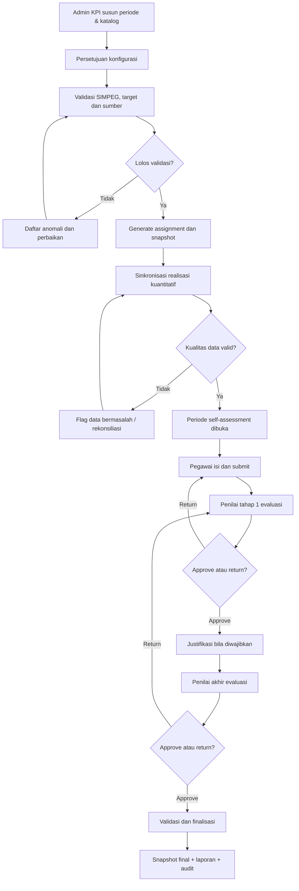

**Catatan:** untuk KW tidak ada tahapan Kabid dan untuk tiap kasus alur aktual diambil dari workflow template. Diagram ini menunjukkan jalur umum, bukan menambah step untuk KW.

### 6.1 Lifecycle periode

`draft` → `configured` → `validated` → `scheduled` → `open` → `reviewing` → `closed` → `finalized` → `archived`.

**[USULAN]** Pisahkan *period status* dari *assessment status*. Mengakhiri periode pengisian tidak otomatis memfinalisasi seluruh penilaian. Jika ada penilaian tertunda, sistem mempertahankan status pengecualian berikut escalation/approval yang sah.

### 6.2 Lifecycle penilaian

`draft` → `self_assessment` → `submitted` → `under_review` → `approved` → `finalized`; cabang proses `returned_for_revision`, `rejected`, `correction_requested`, `superseded`. **[USULAN]** `approved` berarti semua penilai sudah menyetujui; `finalized` berarti nilai/snapshot sudah tervalidasi dan terkunci secara transaksional.

```mermaid
stateDiagram-v2
  [*] --> Draft
  Draft --> SelfAssessment: periode dibuka
  SelfAssessment --> Submitted: pegawai submit
  Submitted --> UnderReview: tugas reviewer dibuat
  UnderReview --> Returned: reviewer return + alasan
  Returned --> SelfAssessment: perbaikan pegawai
  Returned --> UnderReview: perbaikan reviewer sebelumnya
  UnderReview --> Rejected: keputusan khusus
  UnderReview --> Approved: semua tahapan approve
  Approved --> Finalized: quality gate + lock
  Finalized --> CorrectionRequested: pengajuan koreksi
  CorrectionRequested --> Finalized: koreksi ditolak
  CorrectionRequested --> Superseded: koreksi disetujui; versi baru diterbitkan
  Rejected --> [*]
  Finalized --> [*]
  Superseded --> [*]
```

## 7. Kebutuhan proses per lingkup kantor

### 7.1 KC/KK

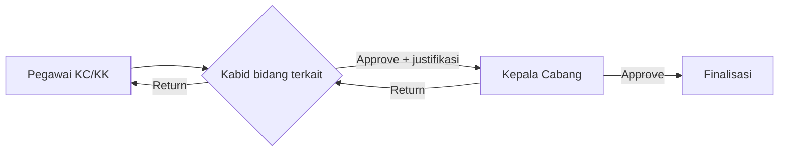

Kasus: Teller → Kabid Operasional → Kacab; AO Kredit → Kabid Pemasaran → Kacab. Semua penentu jabatan berbasis konfigurasi dan snapshot SIMPEG, bukan string hardcode.

### 7.2 KW


### 7.3 KP


### 7.4 Prinsip status dan perilaku tombol

| Status/tahap | Pelaku | Tindakan | Validasi sebelum tindakan |
|---|---|---|---|
| `self_assessment` | Pegawai | Simpan draft, submit | Semua indikator wajib lengkap; bukti jika required |
| `submitted` | Sistem | Buat task tahap 1 | Reviewer ditemukan, assignment tidak diblokir |
| `under_review` | Reviewer aktif | Nilai, catatan, approve/return | Reviewer tepat; jika return alasan wajib |
| `under_review` KC Kabid | Kabid | Submit justifikasi | Ringkasan, kendala, tindak lanjut memenuhi syarat |
| `approved` | Sistem / pihak berwenang | Finalisasi | Bobot sah, skor valid, data sumber valid, semua step selesai |
| `finalized` | Pegawai/viewer | Lihat/cetak | Mutasi nilai dilarang |
| `correction_requested` | Pejabat berwenang | Setujui/tolak koreksi | Alasan, evidence, kontrol maker-checker dan versi baru |

## 8. Desain katalog KPI, target, dan pembobotan

### 8.1 Taksonomi indikator

| Dimensi | Nilai yang didukung | Contoh penggunaan |
|---|---|---|
| Jenis | `quantitative`, `qualitative` | Penyaluran kredit vs kerja sama |
| Subjek ukuran | `employee`, `office`, `branch`, `region`, `division` | AO individual vs target cabang |
| Arah | `higher_is_better`, `lower_is_better`, `custom` | Penyaluran vs NPL |
| Sumber target | `manual_approved`, `import`, `source_system` | Target yang disahkan vs data RBB |
| Sumber realisasi | `api`, `approved_view`, `etl`, `manual_exception` | Data monitoring vs pengecualian resmi |
| Tipe periode ukur | `flow`, `stock`, `ratio`, `count`, `qualitative_scale` | Total kredit baru vs baki debet posisi akhir |
| Pola agregasi | `SUM`, `COUNT`, `AVG`, `LAST_VALUE`, `RATIO_OF_SUMS`, `CUSTOM` | Pertumbuhan, volume dan rasio |
| Distribusi target unit | `unit_shared`, `employee_allocated`, `contribution_based` | Target cabang bersama vs target AO |

**Catatan untuk indikator perbankan:** angka *flow* selama periode dan angka *stock* pada tanggal posisi tidak boleh dijumlahkan dengan aturan sama. Rasio seperti NPL sebaiknya dihitung dari **pembilang/penyebut yang tepat** (misalnya `RATIO_OF_SUMS` bila cocok), bukan rata-rata sederhana rasio antarunit. Setiap indikator membutuhkan data dictionary resmi dari pemilik data.

### 8.2 Kandidat indikator — bukan daftar resmi [USULAN]

| Bidang/konteks | Contoh indikator | Perhatian pengukuran |
|---|---|---|
| Bisnis kredit | Penyaluran/realisasi kredit, baki debet, pertumbuhan portofolio | Flow vs stock; atribusi AO dan tanggal realisasi |
| Kualitas kredit | NPL gross/net, tunggakan, kolektibilitas, pemulihan | Definisi regulator dan denominasi harus disahkan |
| Dana | Pertumbuhan tabungan/deposito/DPK, NOA | Nilai posisi vs pertumbuhan; produk/branch mapping |
| Keuangan | Laba, pendapatan, efisiensi | Periode akuntansi dan alokasi unit |
| Nasabah/layanan | Pembukaan rekening, nasabah aktif, ketepatan layanan | Kualitas data dan definisi nasabah unik |
| Proses/SDM | SLA proses, kepatuhan penyelesaian tugas, disiplin | Hindari pengukuran subjektif tanpa rubrik |
| Kualitatif | Integritas, kerja sama, tanggung jawab, pelayanan, kepemimpinan | Rubrik per level dengan bukti terstruktur |

Metrik di atas hanya kandidat desain. Tidak ada angka target, ambang batas NPL, predikat atau bobot yang dianggap resmi.

### 8.3 Template dan inheritance indikator [USULAN]

Aturan assignment dapat disusun berdasarkan `global` → `lingkup` → `group_jabatan` → `kode_jabatan` → `unit_kerja` → `employee`. Benturan dua aturan pada prioritas sama harus menghasilkan daftar konflik dan tidak diaktifkan secara diam-diam. Prioritas ini adalah **usulan teknis**, perlu persetujuan SDM/HC.

Setiap paket indikator aktif wajib memenuhi: identitas unik, kategori, definisi, subjek, formula version, target policy, bobot, skala/rubrik, sumber realisasi, owner, *effective_from* dan *effective_to*; semua memiliki riwayat approver. Pengubahan master tidak mengubah assessment yang sudah terbentuk.

### 8.4 Target dan perubahan target

- Target dapat dibuat melalui input terotorisasi atau impor massal tervalidasi dari sumber yang ditunjuk.
- Target unit/cabang **tidak otomatis** menjadi target per orang; pemilik KPI menetapkan aturan alokasi/berbagi.
- Revisi target selama periode aktif harus memiliki pembuat, alasan, waktu efektif, persetujuan, nilai lama, nilai baru, dan dampak terhadap penilaian yang belum final.
- Pengesahan target dan realisasi tetap dipisahkan; data target tidak boleh ditimpa oleh job realisasi.
- Jika target belum sah atau kosong, skor indikator ditandai `not_calculable`, bukan diisi nol.

### 8.5 Bobot dan formula — konfigurasi kebijakan [KEPUTUSAN]

Komposisi kuantitatif:kualitatif **belum ditetapkan**. Rumus dua-kelompok di bawah adalah baseline v2.0. Dengan keputusan baru, komponen kuantitatif dapat dikelompokkan menurut atribusi individu dan unit/cabang. Sistem harus mendukung komposisi bertingkat atau tiga komponen sesuai bobot yang kelak disahkan (lihat Bagian 28.5); kedua formulasi **tidak** dipakai bersamaan. Rumus konseptual baseline:

```text
quant_score = SUM(final_quant_indicator_score_i × indicator_weight_i / 100)
qual_score  = SUM(final_qual_indicator_score_j  × indicator_weight_j / 100)
final_score = quant_score × quantitative_weight / 100
            + qual_score  × qualitative_weight / 100
```

**Quality gate skor:** jumlah bobot kelompok tepat 100% untuk konfigurasi aktif; bobot indikator dalam kelompok yang digunakan tepat 100%; seluruh skor menggunakan skala seragam yang disahkan; aturan pengecualian indikator yang *not_applicable* harus eksplisit; perubahan versi rumus tidak mengubah penilaian lama.

Formula contoh awal (seperti v1.0):

```text
higher_is_better: achievement_pct = realization / target × 100
lower_is_better : achievement_pct = target / realization × 100
custom          : fungsi terdaftar berdasarkan versi formula disahkan
```

**Perhatian:** formula dasar bukan aturan penilaian final. Formula NPL, jumlah negatif, realisasi nol/target nol, pembulatan, penalti, dan skor maksimum harus dimodelkan per indikator. `target=0` dan `actual=0` **tidak otomatis** berarti 100%; penyelesaian mengikuti kebijakan resmi.

### 8.6 Matriks kasus batas kalkulasi

| Kasus | Perilaku sistem yang diusulkan |
|---|---|
| Target NULL / belum disahkan | `pending_target`; tidak dapat difinalisasi |
| Realisasi NULL / integrasi gagal | `pending_data`; tidak dihitung sebagai nol |
| Target 0, realisasi bukan 0 | Menggunakan *zero-target policy* yang disetujui |
| Target dan realisasi 0 | Menggunakan *zero-zero policy* yang disetujui |
| Indikator lower-is-better, realisasi 0 | Menggunakan rule khusus; tidak dibagi nol |
| Nilai negatif | Hanya valid bila metrik mengizinkan dan rule terdefinisi |
| Achievement lebih dari 100% | Cap/floor atau bonus hanya bila kebijakan mendefinisikan |
| Indikator tidak berlaku | `not_applicable` dengan alasan dan otorisasi; normalisasi perlu keputusan |
| Selisih sumber dan KPI | `reconciliation_failed`; jangan finalisasi sampai diselesaikan |
| Formula diganti setelah lock | Hasil lama tetap pada versi dan snapshot semula |

### 8.7 Rubrik kualitatif [KEPUTUSAN]

Setiap indikator kualitatif harus menggunakan skala dengan *anchor* perilaku yang dapat ditinjau. Misalnya kategori kinerja dapat berupa lima tingkat, tetapi jumlah tingkat, nama kategori, skor numerik, definisi bukti wajib dan aturan atasan mengubah nilai **belum resmi**. Penilai harus dapat menjelaskan alasan ketika skor reviewer berbeda dari self-assessment menurut ambang yang disetujui.

## 9. Integrasi realisasi kuantitatif dan data governance

### 9.1 Sumber dan batas integrasi

**SIMPEG** untuk master organisasi/identitas; **Core Banking / data mart / MONBIS / sumber lainnya** hanya jika disetujui pemilik data. Nama-nama ini adalah kandidat jalur integrasi, bukan bukti ketersediaan API, tabel, maupun data KPI final. Setiap indikator harus memiliki `data_contract` yang memuat owner, koneksi logis, query/view/API yang disetujui, filter, satuan, timezone, schedule, *as-of date*, kunci unik, dan kriteria rekonsiliasi.

### 9.2 Prinsip teknis

1. Preferensi: API atau curated data mart/view read-only yang stabil, bukan query bebas dari form admin.
2. Parameterized query, allowlist source, credential vault/secret manager dan user hak minimum.
3. ETL terjadwal dan manual *authorized retry*, dengan idempotency key berbasis sumber, indikator, subjek, periode, cut-off dan versi definisi.
4. Simpan satuan sumber dan hasil normalisasi (contoh Rp, persen, NOA) beserta presisi `DECIMAL`.
5. Staging menerima data lalu memvalidasi schema, tipe, posisi tanggal, key, rentang dan duplikasi sebelum *publish*.
6. Eksekusi update snapshot nilai dalam transaksi yang atomic; jika batch gagal, nilai yang telah valid sebelumnya tidak dihapus sebelum pengganti siap.
7. Rekonsiliasi total/numerator/denominator sesuai rumus; status `valid`, `warning`, `invalid`, `stale` harus ditampilkan.
8. Data *late-arriving* boleh memperbarui assessment nonfinal sesuai aturan refresh dan audit; assessment final tetap terkunci.
9. Notifikasi jika jumlah record menyusut anomali, tidak ada data pada cut-off, sumber tidak tersedia, atau selisih di atas toleransi.

### 9.3 Alur integrasi

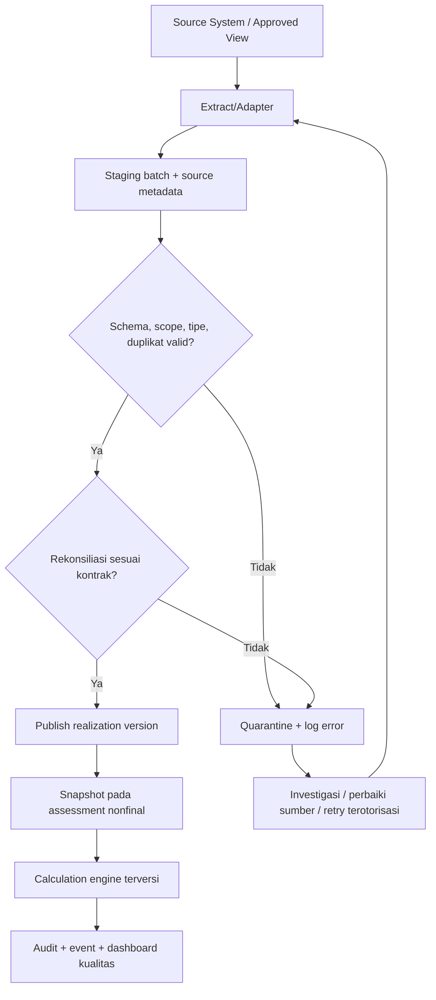

### 9.4 Kontrak data minimal per indikator

| Field | Contoh/aturan |
|---|---|
| `source_code`, `source_version` | Nama logis sistem dan versi data contract |
| `indicator_code`, `formula_version` | Kode indikator dan formula yang aktif |
| `subject_type`, `subject_key` | employee/office/branch/division dan ID konsisten |
| `period_start`, `period_end`, `as_of_date` | Periode kinerja serta tanggal posisi |
| `numerator`, `denominator`, `raw_value` | Sesuai metode ukuran; boleh null jika tak relevan |
| `unit`, `decimal_scale` | Unit asli dan hasil normalisasi |
| `record_count`, `checksum` | Bukti ukuran batch dan deteksi perubahan |
| `extracted_at`, `published_at` | Waktu ekstraksi dan rilis |
| `quality_status`, `error_code` | Validasi terstruktur |
| `source_reference` | ID batch, view/version, atau tautan internal aman |

### 9.5 Skenario sinkronisasi wajib

**SYNC-01:** insert sukses; **SYNC-02:** retry sama menghasilkan satu publikasi logis; **SYNC-03:** data benar-benar nol; **SYNC-04:** data kosong/gagal (tetap NULL); **SYNC-05:** duplikat key; **SYNC-06:** perubahan angka sebelum final; **SYNC-07:** perubahan angka sesudah final memicu review koreksi, tidak menimpa; **SYNC-08:** selisih rekonsiliasi; **SYNC-09:** sumber terlambat; **SYNC-10:** timeout di tengah batch tidak menyebabkan data parsial.

## 10. Persetujuan, revisi, dan koreksi

### 10.1 Workflow template dan runtime

Template menggambarkan `office_scope`, rule pegawai, langkah penilai, `is_justification_required`, jenis aksi dan aturan return. Ketika assessment dibentuk, sistem **menginstansiasi** template ke step runtime dan mencatat `approver_employee_id`, `position_snapshot`, `due_at` dan urutan. Status runtime `pending`, `active`, `approved`, `returned`, `rejected`, `skipped_by_authorization` (jika kebijakan mengizinkan). Hanya satu step aktif per assessment (kecuali workflow paralel disetujui di masa depan).

### 10.2 Return vs reject

- **Return:** mengembalikan ke langkah yang diperbolehkan, alasan wajib, revisi tetap dalam assessment dengan version number bertambah; keputusan terdahulu tetap tersimpan.
- **Reject:** menghentikan workflow; status `rejected`, alasan dan penanda pejabat resmi wajib; re-open hanya melalui prosedur khusus.
- **Approve:** memverifikasi kelengkapan reviewer, justifikasi, kualitas data, dan catatan; sistem menolak aksi dari reviewer tidak aktif.
- **Finalisasi:** setelah langkah akhir disetujui dan semua *quality gates* lolos, sistem membuat final snapshot/hash, lock nilai dan mengirim notifikasi.

### 10.3 Koreksi setelah final [USULAN]

`request` → `review` → `approve/reject` → bila approve, **buat revision baru** terkait `supersedes_assessment_version_id`; pertahankan hasil final versi lama sebagai `superseded`, dan simpan siapa memutuskan, kapan, alasan, serta data mana yang dikoreksi. Pihak pemberi persetujuan dan ambang koreksi **[KEPUTUSAN]**. Jangan mengubah `final_score` lama melalui UPDATE diam-diam.

### 10.4 Deadline dan eskalasi [KEPUTUSAN]

Periode dukung triwulan, semester, tahunan dan custom jika dibolehkan; tanggal mulai/sampai untuk pengukuran dibedakan dari jendela isi/review. Eskalasi tugas terlambat dapat berupa notifikasi internal dan supervisor, tetapi frekuensi, tujuan, konsekuensi melewati deadline, dan hak reopen harus ditetapkan pengelola proses.

## 11. Kebutuhan fungsional terstruktur

| ID | Modul | Requirement | Acceptance utama |
|---|---|---|---|
| FR-01 | Identitas | Login akun perusahaan, logout, session expiry, profile SIMPEG | Akses tanpa otorisasi ditolak |
| FR-02 | Otorisasi | RBAC+scope+assignment per endpoint | Reviewer lintas cabang tidak dapat membaca/approve |
| FR-03 | Org sync | Sinkronisasi pegawai, jabatan, unit, hierarki | Anomali aktif ditandai; tak ada pemilihan acak |
| FR-04 | Periode | CRUD, jadwal, kalender dan status; overlap policy | Periode invalid tidak dapat dibuka |
| FR-05 | Katalog | CRUD indikator, versi, owner, formula, sumber, status | Versi historis tidak berubah |
| FR-06 | Bobot/rubrik | Konfigurasi dan approval bobot, skala, cap/floor | Tidak final bila bobot tidak sah |
| FR-07 | Template | Paket KPI dan assignment rules | Konflik aturan terdeteksi |
| FR-08 | Target | Input/import/revisi target dengan version dan approval | Jejak perubahan tersedia |
| FR-09 | Integrasi | Adapter sumber, staging, sync, retry dan logs | Null dan nol terbedakan |
| FR-10 | Kualitas data | Rekonsiliasi, cut-off, status stale, lineage | Perbedaan signifikan memblokir kalkulasi |
| FR-11 | Generate | Generate assessment + org/target/weight/approver snapshot | Idempotent per period/employee/version |
| FR-12 | Self review | Pengisian, catatan, bukti, draft/submit | Lengkap sebelum submit; angka sumber read-only |
| FR-13 | Reviewer | Inbox, penilaian, catatan, keputusan | Hanya reviewer pada active step |
| FR-14 | Justifikasi | Form KC Kabid dan histori | Wajib hanya pada step yang dikonfigurasi |
| FR-15 | Workflow | Dynamic step instance, return, reject, delegation | Seluruh transisi terekam |
| FR-16 | Scoring | Kalkulasi formula terversi, explainable result | Nilai dapat dihitung ulang dari snapshot |
| FR-17 | Finalisasi | Lock, snapshot, hasil dan nomor dokumen | Final tidak berubah dengan sync baru |
| FR-18 | Koreksi | Usulan/review/approve, versi baru | Tidak overwrite nilai lama |
| FR-19 | Monitoring | Dashboard progres/kinerja/kualitas data | Filter scope berlaku di server |
| FR-20 | Laporan | Individu, unit, cabang, wilayah, divisi, ekspor | PDF/Excel mengikuti filter dan otorisasi |
| FR-21 | Notifikasi | In-app dan kanal yang disahkan | Tidak bocorkan data KPI lewat pesan |
| FR-22 | Audit | Event log dan audit trail sensitive actions | Siapa/kapan/sebelum/sesudah/alasan tersedia |
| FR-23 | Admin ops | Job monitor, error queue, retry, feature flags | Kegagalan dapat diinvestigasi tanpa edit DB manual |
| FR-24 | Exception | Mutasi, PLT, jabatan ganda, target N/A, sumber gagal | Case ditahan/ditangani dengan otorisasi |

### 11.1 User stories inti

- **US-01 Pegawai:** sebagai pegawai, saya melihat target, realisasi dan waktu data terbaru agar dapat mengisi self-assessment tanpa mengubah angka sumber.
- **US-02 Kabid KC:** sebagai Kabid terkait, saya dapat review dan mengisi justifikasi sehingga Kacab memahami hasil dan kendala bisnis.
- **US-03 Kacab:** sebagai Kacab, saya dapat menyetujui atau mengembalikan hasil pegawai cabang dengan alasan yang tercatat.
- **US-04 Korwil:** sebagai Korwil, saya menerima tugas langsung bagi pegawai KW tanpa tahapan Kabid.
- **US-05 Kadiv:** sebagai Kadiv, saya meninjau evaluasi Kabid lalu memutuskan tahap akhir KP.
- **US-06 Admin KPI:** sebagai admin, saya melihat anomali penugasan sebelum periode dibuka agar tidak ada pegawai tanpa penilai.
- **US-07 Data owner:** sebagai pemilik data, saya dapat menelusuri nilai KPI ke hasil ekstraksi, posisi data, dan definisi metrik.
- **US-08 Auditor:** sebagai auditor, saya dapat menelusuri riwayat skor, approval, delegasi dan koreksi tanpa mengubah isi.

## 12. Desain layar dan pengalaman pengguna

| Halaman | Pengguna utama | Komponen minimum |
|---|---|---|
| Dashboard saya | Pegawai | Periode aktif, progres, target vs realisasi, tugas, deadline |
| KPI saya | Pegawai | Tab kuantitatif, kualitatif, bukti, catatan, status sumber |
| Self-assessment | Pegawai | Draft autosave, rubrik, upload aman, preview sebelum submit |
| Inbox evaluasi | Reviewer | Daftar tugas, aging, filter cabang/unit, pending return |
| Detail review | Reviewer | Summary, tabel indikator, histori, audit, alasan keputusan |
| Justifikasi bisnis | Kabid KC | Ringkasan, supporting factors, kendala, tindak lanjut, indikator terkait |
| Approval akhir | Kacab/Korwil/Kadiv | Riwayat, nilai, data quality, validasi final |
| Monitoring periode | Admin KPI/SDM | Matriks unit vs status, mismatch, keterlambatan, review gate |
| Katalog KPI | Admin KPI/pemilik indikator | Indikator, versi, draft/approve/aktif, formula sandbox |
| Target & bobot | Admin KPI/pemilik proses | Import, mapping, perbandingan versi dan simulasi |
| Workflow designer | Admin KPI | Template KC/KW/KP, reviewer resolver test, prioritas |
| Integrasi & kualitas | TI/owner | Daftar sumber, status batch, data freshness, rekonsiliasi, retry |
| Laporan | Viewer/SDM/manajemen | Rekap dan drill-down sesuai scope; ekspor terotorisasi |
| Audit & koreksi | Auditor/otoritas | Event, old/new, chain approval, request koreksi |

**[USULAN] UI responsif:** desktop menampilkan tabel dan panel detail; mobile menampilkan daftar tugas dan formulir bertahap. Tampilan angka sensitif dibatasi di frontend **dan** response API. Jangan memuat seluruh penilaian cabang lalu menyembunyikan sebagian di frontend.

## 13. Arsitektur solusi yang diusulkan

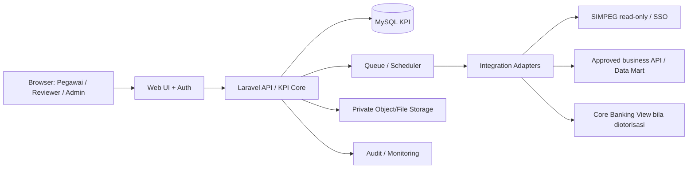

**[USULAN]** Fase 1 dapat menggunakan *modular monolith* Laravel dengan bounded modules `Identity & Organization`, `Catalog & Policy`, `Period & Assignment`, `Data Integration`, `Assessment & Scoring`, `Workflow`, `Report`, `Audit`. Ini mengurangi overhead service orchestration dibanding microservices tanpa menggabungkan aturan bisnis ke satu controller. Jika perusahaan sudah memiliki backend SSO/API pusat, gunakan mekanisme terpusat yang tersedia setelah kontrak dipastikan.

### 13.1 Boundary dan komponen

| Komponen | Tanggung jawab | Penyimpanan utama |
|---|---|---|
| Identity/Org adapter | Login integration, resolve SIMPEG, snapshot jabatan dan kantor | Cache terbatas + snapshot KPI |
| Configuration engine | Versi indikator, skala, bobot, target, formula | KPI DB |
| Assessment engine | Generate header, detail, calculable validation | KPI DB |
| Integration pipeline | Tarik data, validasi, rekonsiliasi dan publish | Staging + KPI DB |
| Workflow engine | Runtime step, approve, return, delegation dan correction | KPI DB |
| Reporting & exports | Rekap, ekspor, authorized projection | Read model / KPI DB |
| Notification worker | Pengingat dan notifikasi aman | Outbox + delivery status |
| Audit/observability | Event immutable secara aplikasi, trace dan health checks | Audit log terproteksi |

### 13.2 Diagram urutan submit dan approval

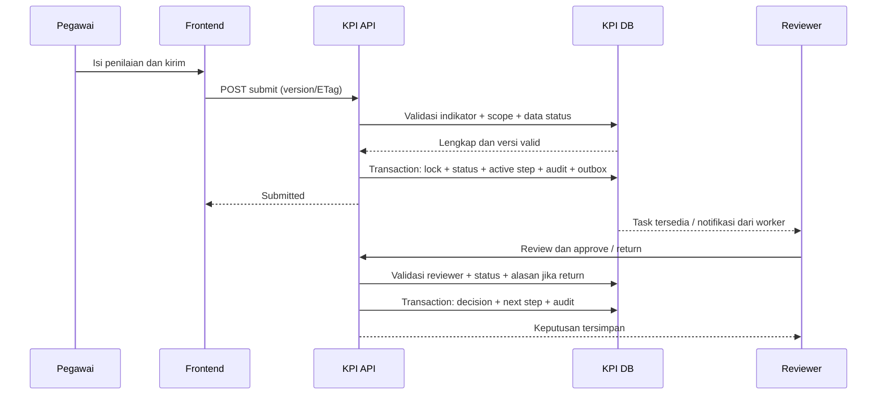

## 14. Rancangan ERD dan database logis

### 14.1 Konvensi desain

- Nama tabel `kpi_*`; primary key `BIGINT UNSIGNED` atau UUID/ULID bila standar perusahaan mengharuskan, **pilih satu pola sebelum DDL final**.
- Relasi internal menggunakan FK; identitas SIMPEG dan sumber bisnis disimpan sebagai *external reference*, bukan FK antar-DB yang rapuh.
- Nominal dan skor `DECIMAL`, bukan `FLOAT`; tanggal bisnis `DATE`, timestamp audit `DATETIME(6)` UTC atau zona standar yang disepakati.
- Master konfigurasi bersifat versioned, assessment menduplikasi snapshot nilai yang diperlukan audit.
- Status menggunakan enumerasi yang dipusatkan di aplikasi + constraint yang sesuai dukungan database, bukan string bebas.
- Row transaksi penting memiliki `created_at`, `updated_at`, `created_by`, `row_version` bila diubah.
- Deletion: transaksi dan audit tidak dihapus fisik lewat operasi normal. Master yang pernah dipakai harus dinonaktifkan, bukan dihapus.

### 14.2 ERD A — konfigurasi KPI dan target

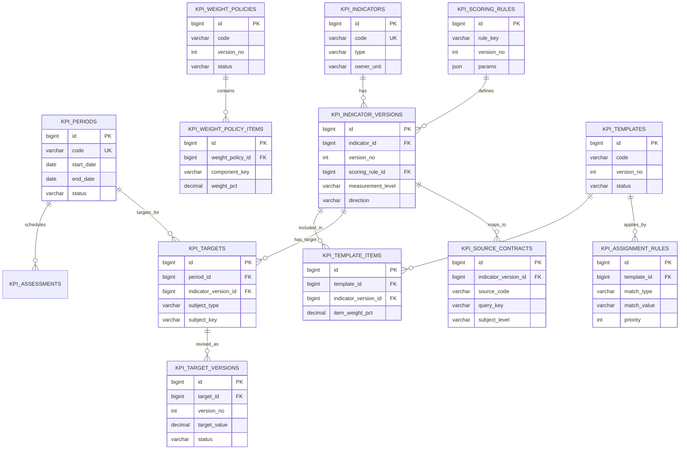

### 14.3 ERD B — penilaian, organisasi, workflow

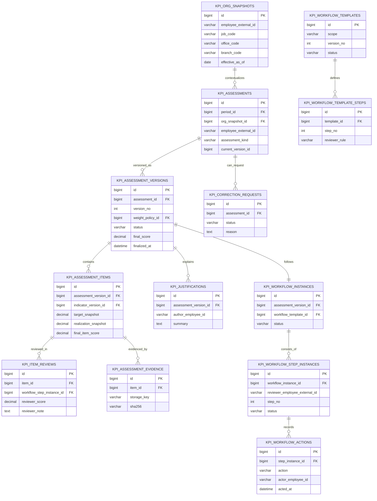

### 14.4 ERD C — realisasi, integrasi, audit

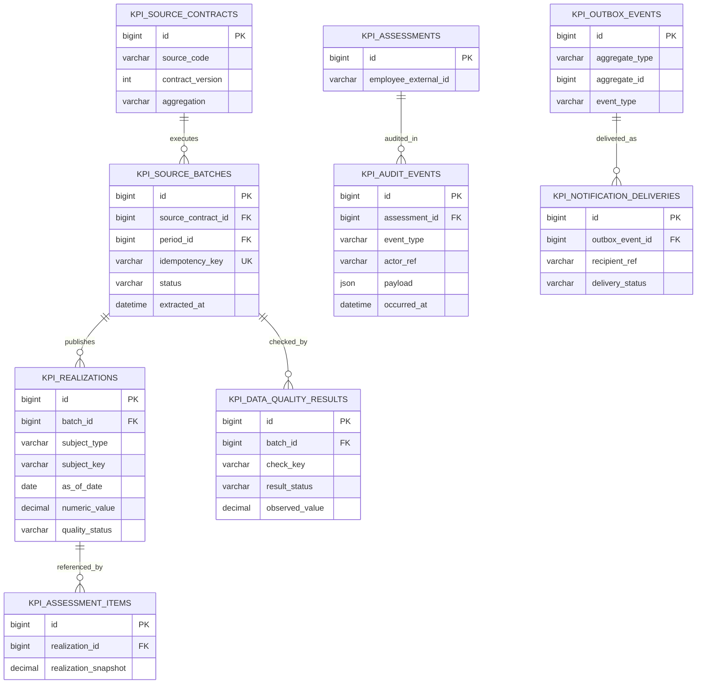

**Penjelasan keputusan model:** `kpi_assessments` adalah identitas permanen satu penilaian per pegawai/periode/jenis, `kpi_assessment_versions` adalah versi transaksi yang dapat dikunci, sedangkan detail indikator berada di bawah **versi**. Dengan pola ini koreksi final tidak perlu mengubah versi lama. `kpi_workflow_step_instances` menyimpan orang penilai yang sebenarnya, berbeda dari `kpi_workflow_template_steps` yang hanya menyimpan aturan.

### 14.5 Kamus tabel per modul

| Tabel | Primary key / kolom inti | Fungsi dan constraint kunci |
|---|---|---|
| `kpi_periods` | `id`, `code`, `period_type`, `start_date`, `end_date`, `self_start`, `self_deadline`, `review_deadline`, `final_deadline`, `status` | UNIQUE `code`; validasi tanggal dan overlap scope |
| `kpi_indicators` | `id`, `code`, `type`, `owner_unit`, `is_active` | UNIQUE `code`; master identitas lintas versi |
| `kpi_indicator_versions` | `id`, `indicator_id`, `version_no`, `name`, `definition`, `unit`, `direction`, `measurement_level`, `scoring_rule_id`, `effective_from/to`, `status` | UNIQUE (`indicator_id`,`version_no`); ubah melalui versi baru |
| `kpi_scoring_rules` | `id`, `rule_key`, `version_no`, `params_json`, `approved_by/at` | Registry formula terversi dan dapat diuji |
| `kpi_weight_policies` | `id`, `code`, `version_no`, `scope_*`, `status`, `approved_by/at` | UNIQUE (`code`,`version_no`); approval sebelum aktif |
| `kpi_weight_policy_items` | `id`, `weight_policy_id`, `component_key`, `weight_pct` | Bobot kelompok/komponen; total 100% per domain yang berlaku |
| `kpi_qualitative_rubrics` | `id`, `indicator_version_id`, `level_code`, `score_value`, `behavior_anchor`, `evidence_rule` | Rubrik per indikator dan versi; [USULAN tambahan] |
| `kpi_templates` | `id`, `code`, `version_no`, `name`, `status` | Paket KPI relevan terhadap jabatan/lingkup |
| `kpi_template_items` | `id`, `template_id`, `indicator_version_id`, `item_weight_pct`, `is_required` | UNIQUE (`template_id`,`indicator_version_id`) |
| `kpi_assignment_rules` | `id`, `template_id`, `match_type`, `match_value`, `priority`, `effective_from/to` | Rule resolusi template; konflik harus terdeteksi |
| `kpi_targets` | `id`, `period_id`, `indicator_version_id`, `subject_type`, `subject_key`, `status` | UNIQUE (`period_id`,`indicator_version_id`,`subject_type`,`subject_key`) |
| `kpi_target_versions` | `id`, `target_id`, `version_no`, `target_value`, `effective_at`, `reason`, `approved_by/at` | UNIQUE (`target_id`,`version_no`); histori target |
| `kpi_source_contracts` | `id`, `indicator_version_id`, `source_code`, `query_key`, `subject_level`, `aggregation`, `version`, `status` | Query/API hanya yang disetujui |
| `kpi_source_batches` | `id`, `source_contract_id`, `period_id`, `idempotency_key`, `status`, `started_at`, `finished_at`, `record_count`, `checksum` | UNIQUE `idempotency_key`; job/audit |
| `kpi_realizations` | `id`, `batch_id`, `subject_type`, `subject_key`, `as_of_date`, `numeric_value`, `unit`, `quality_status`, `source_ref` | Nilai terukur yang dapat ditelusuri; uniqueness logis menurut kontrak |
| `kpi_data_quality_results` | `id`, `batch_id`, `check_key`, `observed_value`, `expected_value`, `result_status` | Validasi dan rekonsiliasi per batch |
| `kpi_org_snapshots` | `id`, `employee_external_id`, `job_assignment_external_id`, `job_code`, `job_name`, `office_code`, `office_name`, `branch_code`, `effective_as_of`, `snapshot_json` | Snapshot identitas/hierarki; source external ID |
| `kpi_assessments` | `id`, `period_id`, `employee_external_id`, `assessment_kind`, `org_snapshot_id`, `current_version_id` | UNIQUE (`period_id`,`employee_external_id`,`assessment_kind`) |
| `kpi_assessment_versions` | `id`, `assessment_id`, `version_no`, `status`, `template_version_id`, `weight_policy_id`, `quant_score`, `qual_score`, `final_score`, `finalized_at`, `supersedes_version_id` | UNIQUE (`assessment_id`,`version_no`); immutable setelah final |
| `kpi_assessment_items` | `id`, `assessment_version_id`, `indicator_version_id`, `target_version_id`, `realization_id`, `target_snapshot`, `realization_snapshot`, `achievement_pct`, `item_weight_snapshot`, `self_score`, `final_item_score`, `calculation_json` | UNIQUE (`assessment_version_id`,`indicator_version_id`); semua angka bersumber |
| `kpi_item_reviews` | `id`, `item_id`, `workflow_step_instance_id`, `reviewer_score`, `reviewer_note`, `reviewed_at` | Riwayat review per step, tidak overwrite review sebelumnya |
| `kpi_assessment_evidence` | `id`, `item_id`, `uploader_ref`, `storage_key`, `content_type`, `file_size`, `sha256`, `uploaded_at` | File privat, izin by item dan antivirus/scanning |
| `kpi_workflow_templates` | `id`, `code`, `scope`, `version_no`, `status`, `effective_from/to` | UNIQUE (`code`,`version_no`) |
| `kpi_workflow_template_steps` | `id`, `template_id`, `step_no`, `name`, `reviewer_rule`, `justification_required`, `allowed_return_to` | UNIQUE (`template_id`,`step_no`) |
| `kpi_workflow_instances` | `id`, `assessment_version_id`, `workflow_template_id`, `status`, `active_step_id` | UNIQUE (`assessment_version_id`) |
| `kpi_workflow_step_instances` | `id`, `workflow_instance_id`, `template_step_id`, `step_no`, `reviewer_employee_external_id`, `reviewer_job_snapshot`, `status`, `due_at` | Orang/tahap penilai yang dibekukan, kecuali delegasi resmi |
| `kpi_workflow_actions` | `id`, `step_instance_id`, `actor_ref`, `action`, `from_status`, `to_status`, `note`, `acted_at`, `request_id` | Event keputusan append-only; UNIQUE `request_id` untuk idempotency |
| `kpi_justifications` | `id`, `assessment_version_id`, `step_instance_id`, `author_ref`, `summary`, `supporting_factors`, `obstacles`, `follow_up_plan`, `revision_no` | Justifikasi terversi dan terkait step Kabid |
| `kpi_approver_delegations` | `id`, `from_reviewer_ref`, `to_reviewer_ref`, `scope_json`, `valid_from/to`, `reason`, `approved_by` | Delegasi aktif terotorisasi; [USULAN tambahan] |
| `kpi_correction_requests` | `id`, `assessment_id`, `target_version_id`, `requester_ref`, `reason`, `evidence_ref`, `status`, `decided_by/at` | Maker-checker dan versi koreksi |
| `kpi_audit_events` | `id`, `assessment_id nullable`, `entity_type`, `entity_id`, `event_type`, `actor_ref`, `before_json`, `after_json`, `reason`, `correlation_id`, `occurred_at` | Perubahan sensitif, proteksi hapus/ubah |
| `kpi_outbox_events` | `id`, `aggregate_type/id`, `event_type`, `payload_json`, `status`, `created_at` | Event notifikasi atomik bersamaan commit |
| `kpi_notification_deliveries` | `id`, `outbox_event_id`, `recipient_ref`, `channel`, `status`, `attempts`, `sent_at` | Pengiriman dengan retry tanpa double notification |

### 14.6 Indeks, FK, dan konsistensi transaksi

**Rekomendasi indeks gabungan:**

- `kpi_assessments(period_id, employee_external_id, assessment_kind)` **UNIQUE**.
- `kpi_assessments(period_id, org_snapshot_id)` untuk monitoring posisi awal.
- `kpi_assessment_versions(assessment_id, version_no)` **UNIQUE**; `(status, finalized_at)` untuk dashboard.
- `kpi_assessment_items(assessment_version_id, indicator_version_id)` **UNIQUE**.
- `kpi_workflow_step_instances(reviewer_employee_external_id, status, due_at)` untuk inbox.
- `kpi_workflow_actions(step_instance_id, acted_at)` dan `request_id` **UNIQUE**.
- `kpi_targets(period_id, indicator_version_id, subject_type, subject_key)` **UNIQUE**.
- `kpi_realizations(batch_id, subject_type, subject_key, as_of_date)` sesuai kontrak; jika multi-record valid per subject, perlu `source_row_key`.
- `kpi_source_batches(idempotency_key)` **UNIQUE** dan `(status, started_at)`.
- `kpi_audit_events(entity_type, entity_id, occurred_at)` dan `correlation_id`.

**Transaction boundaries:** generate assessment, submit, approve/return, finalisasi, peralihan current_version, dan publish batch memerlukan transaksi dan kunci idempotency. Gunakan *optimistic locking* (`row_version`) atau `SELECT ... FOR UPDATE` untuk mencegah dua penilai/worker memproses state yang sama secara bersamaan. FK sirkular (`current_version_id`, `active_step_id`) dapat diisi setelah pembuatan record atau diganti read-model pointer agar migrasi aman.

### 14.7 Kebijakan versioning data

| Objek | Kapan versi baru dibuat | Historis berubah? |
|---|---|---|
| Definisi indikator | Formula/definisi/unit/rubrik diganti | Tidak |
| Policy bobot | Bobot lingkup/periode direvisi | Tidak |
| Target | Target direvisi dan disahkan | Tidak |
| Assessment | Koreksi setelah final | Tidak; versi lama ditandai superseded |
| Workflow template | Hierarki/aturan approval berubah | Tidak |
| Source contract | Skema/rumus ekstraksi berubah | Tidak |
| Organisasi | Data SIMPEG berubah | Snapshot terdahulu tetap |

### 14.8 Aturan kepemilikan subjek penilaian [KEPUTUSAN]

Skema perlu mendukung satu indikator dengan satu nilai **level cabang** yang dibaca sejumlah pegawai (shared performance) tanpa membuat salinan data bisnis yang tak terkendali. Tabel `kpi_realizations` menyimpan nilai per *subject business level*; detail penilaian menyimpan snapshot hasil atribusi per pegawai berdasarkan kebijakan. Jika kebijakan menghendaki *allocation*, tambahkan `kpi_target_allocations(period, indicator, source_subject, employee, allocation_value/ratio, approved_by)` agar total alokasi dapat direkonsiliasi ke target unit.

## 15. Kontrak API tingkat tinggi [USULAN]

Seluruh endpoint berikut memerlukan autentikasi perusahaan, otorisasi *policy* server, logging, pagination/limit dan validasi schema. Nama dan versi endpoint dapat disesuaikan standar backend perusahaan.

| Metode + endpoint | Tujuan | Role/scope |
|---|---|---|
| `GET /api/v1/me/kpi` | Periode, daftar KPI, status pegawai | Diri sendiri |
| `GET /api/v1/assessments/{id}` | Detail snapshot dan histori | Owner, reviewer assigned, viewer berizin |
| `PUT /api/v1/assessments/{id}/self` | Simpan draft dengan `row_version` | Owner dan status editable |
| `POST /api/v1/assessments/{id}/submit` | Submit penilaian | Owner; idempotency key |
| `GET /api/v1/reviewer/tasks` | Inbox aktif | Hanya penilai yang ditugaskan |
| `POST /api/v1/reviewer/tasks/{id}/score` | Skor per indikator | Penilai pada step aktif |
| `POST /api/v1/reviewer/tasks/{id}/approve` | Approve step | Penilai aktif, validasi prerequisites |
| `POST /api/v1/reviewer/tasks/{id}/return` | Return dengan alasan | Penilai aktif, tujuan return valid |
| `POST /api/v1/reviewer/tasks/{id}/reject` | Reject berwenang | Bila policy mengizinkan |
| `POST /api/v1/assessments/{id}/corrections` | Ajukan koreksi final | Authorized requester |
| `GET /api/v1/admin/periods` | Kelola dan monitoring periode | Admin KPI sesuai scope |
| `POST /api/v1/admin/periods/{id}/validate` | Dry-run validasi organisasi/target/penilai | Admin KPI |
| `POST /api/v1/admin/periods/{id}/generate` | Generate assignment | Admin KPI, only if gates pass |
| `GET /api/v1/admin/indicators` | Indikator dan versi | Admin KPI/pemilik indikator |
| `GET /api/v1/admin/targets` | Target dan histori | Sesuai kebijakan |
| `GET /api/v1/admin/sync-batches` | Monitor integrasi | TI/owner berizin |
| `POST /api/v1/admin/sync-batches/{id}/retry` | Retry job | TI/owner berizin |
| `GET /api/v1/reports/summary` | Rekap berbasis filter terotorisasi | Viewer sesuai scope |
| `POST /api/v1/reports/exports` | Export async dengan audit | Viewer sesuai scope |
| `GET /api/v1/audit/events` | Query audit terproteksi | Auditor/role eksplisit |

**Contoh payload submit (ilustrasi desain, bukan API final):**

```json
{
  "assessment_id": 1255,
  "expected_row_version": 4,
  "idempotency_key": "submit-kpi-1255-v4",
  "acknowledged_data_cutoff": "2026-09-30"
}
```

**Response semantics:** `400` validation, `401` unauthenticated, `403` unauthorized, `404` not found within allowed scope (jangan bocorkan keberadaan record), `409` stale row version / wrong workflow status, `422` missing business requirements, `503` critical source unavailable. Request approval harus membawa *idempotency key* untuk mencegah double-click menghasilkan dua keputusan.

## 16. Business rules dan invariant lintas modul

| ID | Aturan yang wajib dipenuhi |
|---|---|
| BR-01 | Satu pegawai/jenis penilaian/periode hanya punya satu assessment header; versi boleh banyak. |
| BR-02 | Master identitas pegawai, jabatan dan kantor bersumber dari SIMPEG. |
| BR-03 | Jabatan aktif dipilih berdasarkan tanggal efektif, bukan urutan baris terakhir. |
| BR-04 | Kantor kas masuk cabang induk sesuai `kode_cabang` yang valid. |
| BR-05 | Tidak ada workflow aktif jika penilai tidak ditemukan atau ganda tanpa resolusi. |
| BR-06 | Penilai harus orang yang diassign ke langkah aktif, bukan hanya punya role sama. |
| BR-07 | Satu aksi approval/return menghasilkan satu event terotorisasi dan satu peralihan status. |
| BR-08 | Return wajib mencatat alasan dan tujuan langkah yang diizinkan. |
| BR-09 | Justifikasi pada KC Kabid wajib sesuai template; tidak mengubah angka realisasi. |
| BR-10 | Pegawai tidak dapat mengubah nilai sumber kuantitatif. |
| BR-11 | Target dan realisasi memiliki sumber, tanggal posisi, versi dan status validitas. |
| BR-12 | NULL atau sinkronisasi gagal tidak boleh dikonversi menjadi angka realisasi 0. |
| BR-13 | Bobot disahkan dan jumlahnya valid sebelum skor final dihitung. |
| BR-14 | Formula, skala dan kebijakan nilai berbeda per indikator bila perlu, terversi. |
| BR-15 | Data sumber dan organisasi yang berubah tidak otomatis mengubah assessment final. |
| BR-16 | Correction final membuat revisi berotorisasi, tanpa menghapus sejarah. |
| BR-17 | Export dan dashboard di-query dalam lingkup akses yang diperiksa di backend. |
| BR-18 | Setiap pengambilan data kuantitatif mempunyai log proses, status dan idempotency. |
| BR-19 | Tanggal pengukuran kinerja berbeda dari tanggal deadline evaluasi. |
| BR-20 | Kacab, Korwil dan Kadiv termasuk subjek KPI; reviewer sah di atasnya harus ditetapkan sebelum finalisasi (approval Direksi belum boleh diaktifkan tanpa kebijakan). |
| BR-21 | Dua periode dengan subjek sama yang overlap membutuhkan pengecualian eksplisit bila kebijakan memperbolehkan. |
| BR-22 | Tidak boleh ada keputusan penilai aktif yang bertindak sebagai penilai dirinya sendiri. |
| BR-23 | Skala indikator kualitatif tidak ditetapkan tim TI tanpa owner kebijakan. |
| BR-24 | Semua aksi sensitif melewati transaksi, audit dan policy authorization. |

## 17. Nonfunctional requirements, keamanan dan kontrol

### 17.1 Security & privacy

- Autentikasi SSO/SIMPEG sesuai sistem yang sudah disetujui; TLS/HTTPS end-to-end.
- RBAC + ownership + scope pemeriksaan **backend** untuk semua read, write, export, dan file download.
- Principle of least privilege bagi service account; kredensial koneksi tidak disimpan dalam source control.
- Proteksi Laravel umum: CSRF (untuk session/browser), XSS output encoding, SQL injection prevention, upload validation, session rotation, rate limiting.
- Lampiran disimpan privat; file download melalui signed/authorized access pendek; antivirus, allowlisted MIME dan ukuran maksimal **[KEPUTUSAN]**.
- Enkripsi rahasia/backup dan PII yang perlu perlindungan; kebijakan retensi dan penghapusan terkontrol **[KEPUTUSAN]**.
- Audit critical business events; pembatasan siapa dapat melihat self-assessment, nilai individu, catatan SDM, serta laporan lintas kantor.
- Maker-checker untuk perubahan bobot, formula, target kritis, delegasi dan koreksi final (jika kebijakan menghendaki).
- Pemisahan lingkungan development, staging/UAT, production; data nasabah nyata tidak digunakan di dev tanpa pengendalian.

### 17.2 Reliability dan concurrency

- Semua transisi state dilakukan secara transaksi DB dan memiliki *expected version*.
- Antrean retry menggunakan backoff serta dead-letter/quarantine setelah batas percobaan.
- Job sinkronisasi tidak boleh `DELETE` snapshot valid sebelum nilai pengganti selesai diproses dan divalidasi.
- Gagal antar-sistem tidak boleh menyebabkan penilaian setengah final.
- Restore dan backup diuji berkala; RPO dan RTO **[KEPUTUSAN]** mengikuti kebijakan perusahaan.
- Dashboard dapat menggunakan cache/agregasi asalkan permission scope dipertahankan dan dapat diinvalidate.

### 17.3 Performance — angka benchmark [KEPUTUSAN]

| Area | Target usulan yang perlu disepakati | Cara uji |
|---|---|---|
| Respons p95 detail penilaian | [KEPUTUSAN] | Load test dengan jumlah peserta aktual |
| Respons p95 inbox reviewer | [KEPUTUSAN] | Daftar dengan filter, sort, pagination |
| Kecepatan generate assessment | [KEPUTUSAN] | Seed data seluruh unit dan kasus anomali |
| Freshness sumber bisnis | Per indikator, [KEPUTUSAN] | `as_of_date` dan `synced_at` |
| Availability jam kerja | [KEPUTUSAN] | Monitoring uptime dan incident |
| Ukuran file bukti dan ekspor | [KEPUTUSAN] | Storage/quota dan soak test |

### 17.4 Observability

Minimal log `request_id`, `correlation_id`, `user_ref`, `assessment_id`, `period_id`, `job_id`, tahap, hasil, durasi dan error category. Dashboard operasional wajib membedakan incident integrasi dari penilaian yang belum diisi. Hindari menaruh nilai sensitif, password, atau dokumen bukti dalam application log.

## 18. Laporan, analitik dan pengawasan

### 18.1 Jenis laporan

1. Rekap status siklus KPI per periode, cabang/wilayah/divisi, jabatan dan reviewer.
2. Rincian individu: indikator, target, realisasi, tanggal posisi, nilai self-assessment, penilai, justifikasi, nilai akhir dan histori versi.
3. Perbandingan periode: hanya indikator yang definisi/versinya kompatibel atau diberi penanda perbedaan metodologi.
4. Ringkasan kualitas data: sumber tidak tersambung, record kosong, selisih rekonsiliasi, angka stale.
5. Aging task: pegawai belum submit, reviewer terlambat, penilaian dikembalikan, finalisasi tertahan.
6. Pengecualian organisasi: konflik jabatan, penilai tidak ditemukan, delegasi kadaluarsa, kantor induk tidak cocok.
7. Audit dan koreksi: aksi setiap pihak, perbandingan versi, alasan dan bukti pengesahan.

### 18.2 Filter dan ekspor

Filter: periode, kantor induk, kantor detail, wilayah, divisi, bidang, jabatan/kelompok, jenis indikator, status, data freshness, dan reviewer. Penjumlahan nilai antarlevel harus menghormati *granularity*; jangan menggandakan target cabang per jumlah pegawai. Ekspor wajib mematuhi row-level access yang sama dan mencantumkan waktu ekspor, cakupan, serta versi data.

## 19. Alur pengecualian kritis

### 19.1 Mutasi pegawai di tengah periode [KEPUTUSAN]

Sistem mampu merekam lebih dari satu segmen penugasan organisasi pada periode yang sama. Pilihan aturan bisnis: (A) mengikuti jabatan akhir, (B) jabatan awal, (C) split menurut tanggal, atau (D) review oleh beberapa penilai dan satu finalizer; **belum diputuskan**. Pilihan harus konsisten dalam target, realisasi individu, dan komparabilitas nilai.

### 19.2 PLT, kekosongan, dan reviewer tidak tersedia

Jika reviewer tidak ditemukan, assessment masuk anomali. Admin KPI mengusulkan kandidat sesuai hierarki, SDM/otoritas menyetujui delegasi yang memiliki masa berlaku; backend memvalidasi assignment ulang. Riwayat perubahan penilai harus menunjukkan aktor, alasan dan timestamp; approval terdahulu tidak ditulis ulang.

### 19.3 Sumber data belum siap

Indikator berstatus `pending_data`, tampil jelas kepada pegawai dan reviewer. Jika batas finalisasi terlampaui, keputusan untuk *waive*, carry-forward, perpanjangan deadline atau menunggu data merupakan kewenangan pemilik proses **[KEPUTUSAN]**, bukan fallback teknis ke angka nol.

### 19.4 Target cabang dipakai oleh beberapa pegawai

Harus dibedakan antara `shared_branch_score` (semua pegawai yang ditetapkan memakai nilai cabang yang sama) dan `individual_contribution` (diberi nilai berdasarkan kontribusi/portofolio individu). Mekanisme tersebut menentukan desain data, target alokasi, dan fairness; wajib dikunci sebelum implementasi formula.

### 19.5 Banding/keberatan pegawai [USULAN]

Sediakan fitur permohonan pemeriksaan nilai dengan alasan dan bukti, terpisah dari hak edit realisasi. Status `opened` → `investigating` → `resolved/rejected`; perubahan final hanya melalui koreksi resmi.

## 20. UAT: skenario minimum lintas modul

| UAT ID | Langkah/kondisi | Hasil yang diharapkan |
|---|---|---|
| UAT-01 | Teller di KC dengan hierarki sah | Kabid Operasional → Kacab |
| UAT-02 | AO Kredit di KC dengan hierarki sah | Kabid Pemasaran → Kacab |
| UAT-03 | Pegawai di KK | Workflow mengikuti cabang induk |
| UAT-04 | Pegawai KW | Langsung Korwil; tidak ada langkah Kabid |
| UAT-05 | Staf divisi KP | Kabid → Kadiv |
| UAT-06 | Tidak ada pejabat penilai | Generate diblokir dengan kode anomali |
| UAT-07 | Dua jabatan aktif ambigu | Generate ditahan; tidak pilih acak |
| UAT-08 | Kode kantor tidak punya cabang induk | Anomali organisasi muncul |
| UAT-09 | Konfigurasi bobot belum disahkan | Finalisasi diblokir |
| UAT-10 | Bobot indikator tidak 100% | Aktivasi konfigurasi ditolak |
| UAT-11 | Target NULL | Nilai pending target; tidak nol |
| UAT-12 | Realisasi 0 sah dari sumber | Sistem tampilkan angka 0 dan status valid |
| UAT-13 | Gagal sync sumber | Nilai NULL dengan status error/pending |
| UAT-14 | Batch sync diproses dua kali | Tidak membuat nilai ganda |
| UAT-15 | Rekonsiliasi gagal | Publikasi/finalisasi mengikuti gate error |
| UAT-16 | Self-assessment indikator wajib belum lengkap | Submit ditolak dengan penjelasan |
| UAT-17 | Pegawai mengedit realisasi melalui API | HTTP 403/422; angka tidak berubah |
| UAT-18 | Kabid return ke pegawai tanpa alasan | Aksi ditolak; alasan wajib |
| UAT-19 | Kacab return ke Kabid | Tugas kembali ke Kabid, histori tetap |
| UAT-20 | Korwil approve | Final setelah semua syarat dipenuhi |
| UAT-21 | Kadiv menilai bukan unitnya | Akses diblokir server |
| UAT-22 | Reviewer mencoba double approve | Hanya satu keputusan sah |
| UAT-23 | Dua request approve simultan | Salah satu ditolak karena stale version |
| UAT-24 | Data bisnis berubah setelah final | Nilai final lama tidak berubah |
| UAT-25 | Koreksi final disetujui | Versi baru terbentuk, nilai lama bisa diaudit |
| UAT-26 | Pegawai mutasi | Snapshot lama tetap; kasus baru sesuai policy |
| UAT-27 | PLT reviewer sesuai tanggal berlaku | Hanya PLT valid berwenang |
| UAT-28 | Ekspor cabang lain via ubah query param | Data luar scope tidak keluar |
| UAT-29 | Download bukti milik pegawai lain | Ditolak meski storage key diketahui |
| UAT-30 | Laporan rasio antarunit | Agregasi sesuai aturan indikator, bukan AVG naif |
| UAT-31 | Formula lower-is-better realisasi 0 | Tidak division by zero |
| UAT-32 | Kacab/Korwil/Kadiv sebagai subjek tanpa reviewer yang sah | Assessment terbentuk; reviewer_unresolved dan finalisasi diblokir |

## 21. Kriteria penerimaan dan go-live

Produk **belum layak produksi** apabila masih ada kondisi: (a) satu unit peserta wajib tanpa penilai, (b) formula/bobot belum disetujui tetapi sistem menghitung skor final, (c) sinkronisasi gagal mengubah nilai menjadi nol, (d) API lintas cabang bocor, (e) hasil final dapat di-update tanpa koreksi, (f) job data menghapus snapshot valid secara parsial.

**Minimal exit criteria:** semua UAT critical pass; daftar organisasi valid dan kasus pengecualian memiliki owner; indikator fase 1 memiliki data contract; rekonsiliasi sumber berhasil pada sampel periode; role matrix diuji sebagai owner/reviewer/admin/viewer; restore backup berhasil; audit event lengkap; dan kebijakan penilaian/penandatanganan disahkan oleh pemilik bisnis.

### 21.1 Pilot terbatas [USULAN]

Pilot dengan subset KC, KW, KP yang representatif, masing-masing mencakup pegawai, reviewer, return, finalisasi, dan kasus data quality. Cabang/unit pilot, jumlah pengguna, durasi dan tanggal go-live **[KEPUTUSAN]**. Jangan mengasumsikan kode cabang `001` sampai `007` adalah lingkup pilot resmi.

## 22. Roadmap implementasi berbasis dependency

| Tahap | Hasil kerja | Gerbang persetujuan |
|---|---|---|
| 0. Kebijakan & discovery | Daftar keputusan, DDL SIMPEG/sumber, indikator resmi, contoh data | Owner bisnis dan data menyetujui |
| 1. Foundation | Auth, akses scope, organisasi, audit, period config | Security + org resolver lulus UAT |
| 2. Catalog & scoring | Master indikator/version, template, bobot, target, rule engine | Formula dan bobot disahkan |
| 3. Integration | Source adapters, staging, data quality, reconciliation, logs | Rekonsiliasi sumber valid |
| 4. Assess & workflow | Self-assessment, approval KC/KW/KP, justifikasi | Semua alur dan return lulus UAT |
| 5. Reports & operations | Dashboard, exports, notifikasi, runbook, observability | Performance/security/backup lulus |
| 6. Pilot & rollout | Parallel-run sampel, UAT, pelatihan, cutover | Go/no-go oleh manajemen |

**Rollback plan [USULAN]:** bila go-live gagal, tutup pembuatan penilaian baru, jaga data transaksi KPI dan audit yang telah dibuat, hentikan job tidak aman, rollback deployment aplikasi, lalu lakukan *forward recovery* untuk data yang sah. Jangan mengembalikan snapshot DB lama secara membabi buta bila sudah ada approval baru.

## 23. Risiko dan mitigasi

| Risiko | Dampak | Mitigasi |
|---|---|---|
| Bobot/indikator belum resmi | Skor dianggap keputusan final tanpa dasar | Gate approval sebelum aktivasi/finalisasi |
| Data sumber bisnis berbeda | Nilai tidak kredibel | Data contract, reconciliation dan lineage |
| Jabatan/atasan ambigu | Approval salah orang | Resolver test, snapshot dan anomaly queue |
| Mutasi tengah periode | Ketidakadilan dan perbandingan tidak sah | Kebijakan atribusi dan segmentasi tugas |
| Data mendadak berubah | Histori tidak konsisten | Versioning, cut-off dan correction workflow |
| Penghitungan rasio salah | Distorsi nilai bisnis | Definisi metrik dan UAT edge cases |
| Kebocoran nilai personal | Risiko kerahasiaan | Backend data-level access, audit dan signed files |
| Gangguan source API/DB | KPI terhenti | Retry, stale indicator, isolation dan eskalasi |
| Banyak perubahan kebijakan | Rework besar | Config-driven, versioned policy, maker-checker |
| Performance bulk period | Job lama atau gagal | Queue, batch checkpoint, idempotency, indeks |

## 24. Daftar keputusan bisnis yang harus dikonfirmasi

| Prioritas | ID | Pertanyaan | Pengambil keputusan yang disarankan | Mengunci desain |
|---|---|---|---|---|
| P0 | Q-01 | TERJAWAB OLEH PENGUSUL: semua pegawai termasuk pejabat struktural menjadi peserta; pengecualian eligibility belum diputuskan. | SDM / Manajemen | Scope & generate |
| P0 | Q-02 | TERJAWAB OLEH PENGUSUL: durasi tiga bulan; triwulan kalender, tanggal mulai dan cut-off masih perlu disahkan. | Manajemen / SDM | Kalender & perhitungan |
| P0 | Q-03 | Komposisi kuantitatif:kualitatif per kelompok jabatan dan bobot tiap indikator? | Direksi/pemilik kebijakan | Scoring/finalisasi |
| P0 | Q-04 | Daftar indikator resmi per jabatan/bidang/unit beserta definisi dan formula? | Pemilik proses / SDM | Catalog & source |
| P0 | Q-05 | Target KPI ditetapkan siapa dan persetujuan berjenjang target bagaimana? | Bisnis/SDM/Manajemen | Target approvals |
| P0 | Q-06 | Data realisasi utama dari Core Banking, MONBIS/data mart, atau layanan lain; apakah sumber punya ID pegawai/AO? | Pemilik data / TI | Source integration |
| P0 | Q-07 | TERJAWAB SEBAGIAN: KPI individu dan cabang digabung; detail sharing vs allocation per indikator/jabatan masih perlu disahkan. | Manajemen / Bisnis | Attribution model |
| P0 | Q-08 | Bagaimana mutasi, rangkap jabatan, pegawai baru/berhenti, dan PLT ditangani? | SDM | Snapshot/workflow |
| P0 | Q-09 | Apakah bobot/skala/predikat final sudah memiliki dasar SK atau harus disusun dahulu? | SDM / Manajemen | Activation criteria |
| P1 | Q-10 | Apakah self-assessment mengisi skor kualitatif saja atau juga kinerja/penjelasan kuantitatif? | SDM | Form & review |
| P1 | Q-11 | Kapan realisasi dikunci: saat periode berakhir, setelah rekonsiliasi, atau saat finalisasi? | Data owner / Manajemen | Data cut-off |
| P1 | Q-12 | Bagaimana alur keberatan/koreksi nilai akhir; siapa menyetujui? | SDM / Manajemen | Correction workflow |
| P1 | Q-13 | Apakah Kabid KP juga wajib justifikasi; apakah langkah review tambahan perlu di unit tertentu? | SDM / Pemilik unit | Workflow config |
| P1 | Q-14 | Siapa pengganti pejabat penilai yang kosong/berhalangan dan dasar kewenangannya? | SDM / Manajemen | Delegation |
| P1 | Q-15 | Apakah nilai self-assessment dan atasan ditampilkan ke pegawai selama proses atau hanya setelah final? | SDM | Visibility policy |
| P1 | Q-16 | Siapa dapat melihat rekap seluruh kantor dan detail nilai individu? | Manajemen / SDM | Permission/report |
| P1 | Q-17 | Deadline, notifikasi, eskalasi, dan apakah pengguna boleh submit terlambat? | SDM / Manajemen | Scheduler/status |
| P2 | Q-18 | Kanal notifikasi final: in-app, email, WhatsApp/gateway internal, atau lainnya? | TI / SDM | Delivery adapter |
| P2 | Q-19 | Masa retensi bukti/konten, batas ukuran berkas, SLA, RPO/RTO, jumlah concurrent user? | SDM / TI / Keamanan | NFR/infrastruktur |
| P2 | Q-20 | Apakah diperlukan tanda tangan elektronik/berita acara dan ekspor format khusus? | Legal / SDM | Reporting/final evidence |

**Urutan workshop disarankan:** sesi (1) kebijakan & subjek KPI (Q01–Q05, Q09), (2) atribusi dan sumber bisnis (Q06–Q08, Q11), (3) workflow/akses/koreksi (Q10, Q12–Q17), (4) teknis dan nonfungsional (Q18–Q20).

## 25. Matriks traceability dari kebutuhan ke pengujian

| Sasaran | Modul FR | Bukti pengujian |
|---|---|---|
| Benar penilai dan lingkup | FR-02, FR-03, FR-11, FR-15 | UAT-01..08, 21, 27, 28 |
| Skor sah dan reproducible | FR-05, FR-06, FR-08, FR-16 | UAT-09..12, 24, 31 |
| Data kuantitatif kredibel | FR-09, FR-10 | UAT-12..15, 30 |
| Pengajuan dan persetujuan sah | FR-12..15, FR-17 | UAT-16..23 |
| Histori final tetap | FR-17, FR-18, FR-22 | UAT-24..26 |
| Aman dan dapat diaudit | FR-01, FR-02, FR-20, FR-22 | UAT-21, 28, 29, audit review |

## 26. Lampiran: contoh validasi relasi SIMPEG

Query inspeksi awal (sesuaikan tipe data/tanggal dengan skema aktual):

```sql
SELECT
    j.id_peg,
    j.id_jab,
    j.kode_jabatan,
    j.unit_kerja,
    j.tmt_jabatan,
    j.sampai_tgl,
    j.status_jab,
    mj.nama_jabatan,
    mj.group_jabatan,
    mj.parent_kode_jabatan,
    mj.lingkup,
    k.kode_kantor_detail,
    k.kode_cabang,
    k.nama_kantor,
    k.level AS level_kantor
FROM tb_jabatan j
LEFT JOIN tb_master_jabatan mj ON mj.kode_jabatan = j.kode_jabatan
LEFT JOIN tb_kantor k ON k.kode_kantor_detail = j.unit_kerja
WHERE j.status_jab = 'Aktif'
ORDER BY k.kode_cabang, j.unit_kerja, j.id_peg;
```

**Perhatian:** `status_jab = 'Aktif'` saja belum menjamin valid pada tanggal efektif tertentu; periksa juga `tmt_jabatan`, `sampai_tgl`, duplikasi aktif, data `'0000-00-00'`, dan status master. Recursive CTE dibutuhkan untuk validasi hierarki lebih dari satu tingkat. Tipe data dan koneksi aktual perlu ditinjau sebelum menjadikan query ini kontrak production.

## 27. Definisi selesai (Definition of Ready & Definition of Done)

**Ready untuk coding bisnis:** skema SIMPEG telah diperiksa; sponsor menandatangani role/scope; keputusan P0 telah dijawab; indikator pilot punya owner, formula, target policy, unit, contoh data dan sumber; workflow dan exception cases telah disepakati.

**Done per fitur:** acceptance FR + UAT lulus; punya migration/rollback; authorization test; audit event; monitoring/error handling; dokumentasi endpoint; contoh API; tidak ada hardcoded kebijakan; data staging dapat direkonsiliasi; perubahan tidak merusak hasil final.

---

**Penanda akhir PRD v2.0 — Draft untuk pembahasan dan pengesahan bertahap.**  
**Langkah berikutnya:** jawab pertanyaan Q-01 sampai Q-09 lebih dahulu, kemudian kunci model scoring/assignment dan rapikan ERD menjadi DDL final berdasarkan skema SIMPEG dan sumber bisnis yang nyata.

## 28. Pendalaman aturan bisnis setelah keputusan awal (versi 2.1)

### 28.1 Register keputusan dan batas pengesahan

Keputusan di bawah adalah **arahan desain yang sudah dikonfirmasi oleh pengusul**. Keputusan tersebut menjadi baseline pengembangan PRD v2.1, namun **bukan** pengganti persetujuan formal perusahaan atas kebijakan penilaian.

| ID | Area | Keputusan desain | Masih perlu dikunci |
|---|---|---|---|
| DEC-01 | Peserta | Seluruh pegawai, termasuk pejabat struktural yang berada dalam populasi pegawai | Status pegawai nonaktif, kontrak, probation, Direksi sebagai subjek, minimum masa kerja |
| DEC-02 | Siklus | Setiap periode penilaian berdurasi 3 bulan | Apakah triwulan kalender; jadwal buka, submit, review, dan final |
| DEC-03 | Atribusi bisnis | Indikator bisnis dapat berasal dari pencapaian individu dan pencapaian cabang/unit bersama | Indikator per jabatan, aturan sharing vs alokasi, proporsi bobot |

**Interpretasi yang wajib dipisahkan:** (a) kuantitatif/kualitatif adalah **jenis pengukuran**, sedangkan (b) individu/cabang adalah **tingkat atribusi**. Indikator kuantitatif dapat bersifat individual maupun tingkat unit/cabang; satu indikator kualitatif lazimnya terkait pegawai tetapi tetap tunduk pada rubrik.

### 28.2 Populasi dan eligibility peserta

**BR-25.** Sistem harus mampu membentuk satu assessment utama untuk setiap pegawai yang eligible dalam satu periode tiga bulan, tanpa mengecualikan pegawai karena dia Kabid, Kacab, Korwil, atau Kadiv. Keanggotaan peserta dibaca dari SIMPEG dan disimpan sebagai snapshot.

**BR-26.** Status dan tanggal efektif pegawai/jabatan dihitung pada tanggal kebijakan yang disepakati (misalnya awal periode atau evaluasi akhir). Pegawai baru, pensiun, meninggal, cuti panjang, mutasi, dan dinonaktifkan tidak boleh otomatis diberi skor nol. Aturan ketercakupan, prorata dan pembebasan harus ditetapkan SDM.

**BR-27.** Seorang pegawai dapat sekaligus menjadi subjek KPI pribadi dan penilai untuk bawahannya, tetapi tidak boleh meng-approve penilaian dirinya sendiri atau memberikan keputusan terakhir melalui delegasi yang membentuk konflik kepentingan.

**BR-28.** Tidak ditemukannya penilai pejabat struktural adalah **anomali yang memblokir finalisasi pejabat tersebut**, bukan alasan menghapusnya dari daftar peserta. Sistem menampilkan `reviewer_unresolved` pada monitoring administrasi.

### 28.3 Kalender dan operasi triwulanan

**[USULAN]** Gunakan periode triwulan kalender agar data bisnis selaras dengan pelaporan: Q1 = Januari-Maret; Q2 = April-Juni; Q3 = Juli-September; Q4 = Oktober-Desember. Ini belum mengunci bahwa penilaian dimulai pada Q1 tahun tertentu.

| Fase | Tindakan | Syarat keluar dan data yang dibekukan |
|---|---|---|
| Pra-periode | SDM/KPI Admin menyetujui peserta, indikator, target, bobot, reviewer dan jadwal | Konfigurasi terversi, quality gate lulus |
| Dalam periode | Sinkronisasi realisasi dan status capaian; pengumpulan bukti berjalan | Data diberi `as_of_date`, tidak ada finalisasi dini tanpa kebijakan |
| Tutup pengukuran | Tutup rentang bisnis pada hari terakhir bulan ketiga | Posisi data sementara atau hasil rekonsiliasi ditandai jelas |
| Cut-off data | Pemilik data memvalidasi angka akhir, selisih dan batch sumber | Batch terpilih berstatus valid dan disegel untuk assessment |
| Self-assessment | Pegawai mengisi bukti dan skor/uraian kualitatif sesuai rubrik | Seluruh item wajib selesai, submit tercatat |
| Review berjenjang | Penilai memeriksa nilai, narasi, justifikasi dan sumber | Penilai aktif memutuskan approve/return, tidak self-approve |
| Finalisasi | Pemeriksaan bobot, formula, kelengkapan data dan tahapan approval | Versi hasil final immutable dan laporan diterbitkan |

**BR-29.** Tanggal awal-akhir pengukuran bisnis tidak boleh disamakan dengan deadline self-assessment/review. Tanggal cut-off realisasi dapat terjadi setelah penutupan triwulan sepanjang jadwalnya ditetapkan.

**BR-30.** Target, versi rumus, bobot, partisipan dan aturan atribusi dibekukan pada pembentukan periode; perubahan selama atau setelah periode wajib melewati revisi terotorisasi dengan alasan dan jejak audit.

**BR-31.** Indikator flow (misalnya kredit baru) menggunakan transaksi selama triwulan; indikator stock (misalnya baki debet) menggunakan posisi tanggal yang disetujui; indikator ratio (misalnya NPL) menghitung pembilang dan penyebut dari basis yang konsisten. Jangan menjumlahkan stock bulanan atau merata-ratakan rasio tanpa aturan metrik.

### 28.4 Model KPI gabungan individu dan unit/cabang

Bentuk pengukuran yang dirancang:

1. **Kuantitatif individual**: target dan realisasi melekat pada pegawai. Atribusi wajib memiliki ID pegawai/AO yang dapat dilacak atau mapping resmi dari sumber bisnis.
2. **Kuantitatif unit/cabang**: realisasi melekat pada `unit_kerja`, `kode_kantor_detail`, atau `kode_cabang` yang sah. Nilai dapat dikonsumsi bersama oleh pegawai yang ditentukan template.
3. **Kualitatif personal**: self-assessment + review atasan berdasarkan rubrik dan bukti. Pencapaian indikator bisnis tidak dapat otomatis menggantikan penilaian kualitatif.

**BR-32.** Setiap template KPI wajib menjelaskan indikator mana bersifat `individual`, `shared_unit`, `shared_branch`, atau `allocated_from_unit`. Label ini **bukan** nilai KPI dan tidak mengubah dimensi `quantitative/qualitative`.

**BR-33.** Satu angka realisasi cabang disimpan **sekali per indikator, cabang dan periode data** sebagai sumber bersama, lalu dirujuk oleh beberapa detail penilaian. Hasil pegawai menyimpan snapshot atribusi dan versi kebijakan. Dalam agregasi perusahaan, nilai cabang tidak boleh dihitung ulang sebanyak jumlah pegawai penerimanya.

**BR-34.** Model `shared_branch` memberi *achievement score* cabang yang sama kepada pegawai yang eligible apabila kebijakan menghendakinya. Model `allocated_from_unit` mengalokasikan target unit ke masing-masing pegawai menurut rule yang disahkan. Jangan menggabungkan kedua model secara implisit.

**BR-35.** Metrik individual yang tidak tersedia karena tidak ada data atribusi tidak otomatis diganti oleh metrik cabang atau diberi angka nol. Statusnya `missing_attribution` dan wajib diselesaikan atau mendapat pengecualian resmi.

**BR-36.** Pegawai dengan jabatan yang tidak memiliki KPI penjualan individual tetap dapat memperoleh template KPI yang relevan (proses, mutu layanan, kepatuhan, output pekerjaan, dan/atau unit), tetapi indikator dan bobotnya harus ditetapkan oleh pemilik proses. Tidak ada keharusan setiap jabatan mempunyai seluruh jenis metrik.

#### Matriks kandidat atribusi per jabatan (contoh desain, bukan KPI resmi)

| Kelompok/jabatan | KPI individu (kandidat) | KPI unit/cabang (kandidat) | Kualitatif (kandidat) | Catatan approval |
|---|---|---|---|---|
| AO Kredit KC/KK | Realisasi kredit dan kualitas portofolio atas mapping AO | Target pertumbuhan/kualitas kredit cabang | Analisis, integritas, pelayanan | Kabid Pemasaran -> Kacab (baseline) |
| Teller KC/KK | Akurasi/ketepatan proses bila data terverifikasi | Indikator layanan/operasional cabang | Kedisiplinan, layanan, kerja sama | Kabid Operasional -> Kacab (baseline) |
| Customer Service | SLA dan kualitas penyelesaian layanan bila tersedia | Hasil layanan/DPK cabang jika ditetapkan | Pelayanan dan administrasi | Atasan bidang -> Kacab (konfigurasi) |
| Kabid Pemasaran KC | Hasil program/target bidang yang dapat diatribusikan | Pertumbuhan kredit/DPK dan kualitas portofolio cabang | Kepemimpinan dan pengawasan | Kacab -> [penilai akhir bila disyaratkan] |
| Kabid Operasional KC | SLA, kendali proses, kepatuhan operasional | Kualitas layanan/efisiensi unit/cabang | Kepemimpinan dan pengendalian | Kacab -> [penilai akhir bila disyaratkan] |
| Kepala Cabang | Sasaran manajerial yang disahkan | Pencapaian bisnis dan kualitas keseluruhan cabang | Kepemimpinan, manajemen risiko | Korwil -> Direktur sesuai bidang (v2.3) |
| Staf Kantor Wilayah | Penyelesaian pekerjaan/program wilayah | KPI wilayah bila disahkan | Koordinasi dan mutu kerja | Korwil (baseline) |
| Korwil | Hasil koordinasi dan pengendalian | KPI wilayah yang menjadi kewenangannya | Kepemimpinan | Direktur sesuai bidang (v2.3) |
| Staf Divisi Pusat | Deliverable/SLA fungsi terkait | KPI divisi jika memiliki sumber terukur | Kolaborasi, integritas | Kabid -> Kadiv (baseline) |
| Kabid KP | Output bidang dan penyelesaian program | KPI divisi/unit sesuai tugas | Kepemimpinan dan kontrol | Kadiv -> [penilai akhir bila disyaratkan] |
| Kadiv KP | Realisasi program strategis divisi | KPI unit/divisi atau target korporasi yang disetujui | Kepemimpinan dan tata kelola | Direktur sesuai bidang (v2.3) |

Penting: contoh kandidat tersebut tidak menyatakan bahwa teller memiliki target kredit, seluruh pegawai mendapatkan angka NPL, atau sumber data tertentu sudah tersedia. Tiap KPI perlu matriks owner, formula, target, dan kualitas data sebelum aktif.

### 28.5 Skema bobot dan perhitungan yang dapat dikonfigurasi

**[USULAN MODEL]** Jika kebijakan memakai tiga komponen, formula konseptual yang bisa disiapkan sebagai configurator:

```text
score_individual = SUM(score_metric_i * weight_metric_i) / SUM(weight_metric_i)
score_unit       = SUM(score_metric_u * weight_metric_u) / SUM(weight_metric_u)
score_qual       = SUM(score_metric_q * weight_metric_q) / SUM(weight_metric_q)

final_score = score_individual * weight_individual
            + score_unit       * weight_unit
            + score_qual       * weight_qual
```

Catatan: seluruh `weight_*` di rumus berbentuk pecahan (0..1). Semua kelompok yang **berlaku** harus memiliki bobot dengan jumlah **1.0**, sesuai konfigurasi yang disetujui. Skor tiap kelompok dan skor akhir memakai skala yang sama; skala, cap, pembulatan dan aturan tidak-berlaku belum diputuskan.

**Contoh simulasi matematis, BUKAN kebijakan:** individu 90, unit 80, kualitatif 85, dengan bobot contoh 40%, 35%, 25% menghasilkan `90*0.40 + 80*0.35 + 85*0.25 = 85.25`. Angka bobot contoh tidak boleh dipakai otomatis sebagai default sistem.

**BR-37.** Jika satu komponen tidak berlaku untuk suatu jabatan, sistem tidak boleh mengalihkan bobot sendiri. Harus ada kebijakan alternatif untuk template jabatan tersebut dan divalidasi total bobotnya.

**BR-38.** Jika target kosong, data sumber gagal, atau formula menghasilkan keadaan tak terdefinisi, skor harus `not_calculable`, bukan nol, dan pemrosesan final diblokir sampai resolusi yang berwenang.

**BR-39.** Penilai dapat memberi catatan/justifikasi dan skor kualitatif sesuai rubrik, tetapi tidak berhak menimpa angka kuantitatif dari sumber bisnis. Koreksi sumber dilakukan melalui pemilik data atau prosedur exception yang terpisah.

### 28.6 Penilai pejabat struktural dan konflik rancangan lama

Keputusan baru memasukkan semua pejabat struktural sebagai peserta. Karena itu klausul v2.0 yang meniadakan penilaian Kacab, Korwil dan Kadiv sebagai **subjek** tidak lagi berlaku. Yang tetap **belum disetujui** adalah siapa penilai sahnya dan apakah Direksi terlibat sebagai approver. Mekanisme disiapkan tanpa mengaktifkan penilai yang belum memiliki dasar kewenangan.

| Subjek KPI | Contoh jalur yang sudah ada di baseline | Penyesuaian yang disarankan | Status |
|---|---|---|---|
| Staf KC/KK | Kabid terkait -> Kacab | Tetap, dengan role dan jabatan efektif | Baseline, perlu verifikasi HR |
| Kabid KC | Belum dirinci sebagai subjek | Kacab sebagai kandidat penilai | **[PENDING pengesahan]** |
| Kacab | Dikecualikan dari penilaian pada v2.0 | Perlu penilai struktural di atas Kacab | **[P0 keputusan]** |
| Staf KW | Korwil | Tetap sebagai penilai akhir sesuai baseline | Baseline, perlu verifikasi HR |
| Korwil | Dikecualikan pada v2.0 | Perlu penilai struktural di atas Korwil | **[P0 keputusan]** |
| Staf KP | Kabid -> Kadiv | Tetap sesuai baseline | Baseline, perlu verifikasi HR |
| Kabid KP | Belum dirinci sebagai subjek | Kadiv sebagai kandidat penilai | **[PENDING pengesahan]** |
| Kadiv KP | Dikecualikan pada v2.0 | Perlu penilai struktural di atas Kadiv | **[P0 keputusan]** |
| Pejabat KK | Mengikuti cabang induk | Tetapkan apakah langsung Kacab atau perantara Kabid | **[PENDING]** |

**BR-40.** Semua penilai harus di-resolve menjadi **pegawai tertentu** melalui histori SIMPEG + aturan workflow, bukan sekadar role `kabid` atau nama jabatan. Tidak boleh ada approval otomatis hanya karena pejabat berada pada level tertinggi dalam data.

**BR-41.** Jika pejabat penilai tidak tersedia, delegation/PLT harus memiliki periode berlaku, lingkup tugas, alasan dan dasar mandat. Pengganti tidak boleh meng-approve penilaian dirinya sendiri.

### 28.7 Mutasi, pegawai baru, dan perubahan kepemilikan KPI

**[USULAN DESAIN]** Dukung *segmented attribution*: bila pegawai berpindah cabang dalam satu triwulan, data kinerja individu diambil menurut tanggal dan kantor yang berlaku. KPI cabang bersama dapat menggunakan hasil dari satu cabang atau proporsi waktu di setiap cabang **hanya setelah kebijakan SDM memutuskan metode tersebut**. Semua segmen efektif dan atribusi disimpan untuk audit.

| Peristiwa | Perlakuan aplikasi | Keputusan kebijakan yang tersisa |
|---|---|---|
| Mutasi antar-cabang di bulan ke-2 | Simpan segmen jabatan/kantor sebelum dan sesudah mutasi | Nilai cabang asal/tujuan, prorata atau unit akhir? |
| Promosi menjadi Kabid | Tambahkan histori jabatan dan calon template baru | Satu atau dua penilaian dalam periode? |
| Pegawai baru | Tercatat sebagai kandidat peserta | Minimum masa kerja dan masa observasi? |
| Pensiun/keluar | Amankan histori; tidak menghapus assessment | Tetap dinilai atau dikecualikan? |
| Cuti panjang | Tampilkan eligibility exception | Perlakuan bobot, target dan deadline? |
| PLT/rangkap jabatan | Verifikasi mandat dan konflik penilai | Memiliki satu atau dua paket KPI? |

### 28.8 Alur resolusi KPI gabungan

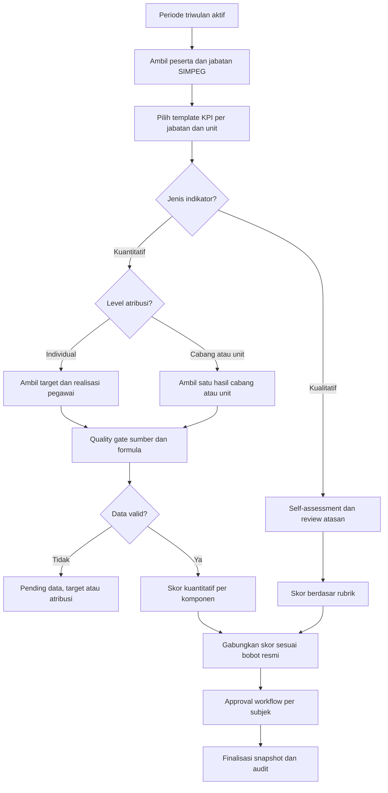

### 28.9 Rancangan tambahan ERD dan skema konseptual

**[USULAN]** Model v2.0 sudah memiliki tabel periode, indikator, target, realisasi dan item penilaian. Untuk kebutuhan gabungan serta mutasi tengah triwulan, perlu diperjelas empat entitas tambahan (bukan berarti semua harus tabel fisik jika tetap dapat dijamin oleh constraint lain):

| Tabel tambahan / perluasan | Kolom logis | Fungsi |
|---|---|---|
| `kpi_attribution_policies` | `id`, `indicator_version_id`, `scope_type`, `strategy`, `version_no`, `valid_from/to`, `approved_by` | Menyimpan keputusan `individual`, `shared_branch`, `shared_unit`, atau `allocated_from_unit` |
| `kpi_assessment_period_segments` | `id`, `assessment_id`, `org_snapshot_id`, `effective_from/to`, `eligibility_status`, `weight_factor` | Mempertahankan riwayat atribusi saat mutasi/jabatan berubah |
| `kpi_assessment_item_sources` | `id`, `assessment_item_id`, `realization_id`, `attribution_policy_id`, `target_version_id`, `source_subject_type/key`, `snapshot_value` | Menghubungkan satu item pegawai dengan data sumber dan aturan atribusi yang sah |
| `kpi_target_allocations` | `id`, `target_id`, `period_id`, `indicator_version_id`, `unit_subject_key`, `employee_ref`, `target_amount`, `allocation_ratio`, `approved_by` | Hanya diperlukan bila target cabang dibagi menjadi target individual secara resmi |

**Constraint dan indeks tambahan yang disarankan:** UNIQUE (`indicator_version_id`, `scope_type`, `version_no`) di kebijakan atribusi dengan validasi tidak overlap yang aktif; INDEX (`assessment_id`, `effective_from`, `effective_to`) pada segmen; UNIQUE (`assessment_item_id`, `realization_id`, `attribution_policy_id`) pada item-source; UNIQUE (`period_id`, `indicator_version_id`, `unit_subject_key`, `employee_ref`) pada alokasi target. Semua foreign key internal harus mempertimbangkan versi assessment agar koreksi final tidak menimpa pointer historis.

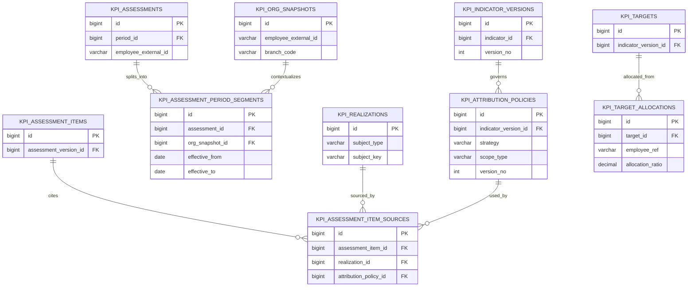

### 28.10 UAT tambahan khusus keputusan v2.1

| ID | Skenario | Hasil yang wajib terjadi |
|---|---|---|
| UAT-33 | Kabid terdaftar pada SIMPEG aktif | Dibuat sebagai peserta KPI, bukan hanya reviewer |
| UAT-34 | Kacab/Korwil/Kadiv tanpa rule penilai yang disahkan | Assessment ada; `reviewer_unresolved`; finalisasi ditolak |
| UAT-35 | Satu nilai kredit cabang dipakai tiga pegawai | Score tiap pegawai sesuai aturan; total kredit cabang pada rekap tidak dikali tiga |
| UAT-36 | Item individual tanpa mapping pegawai/AO | Status `missing_attribution`; bukan nol otomatis |
| UAT-37 | Triwulan dengan satu sumber data gagal | Item tetap pending; penilaian tidak final palsu |
| UAT-38 | Pegawai mutasi di tengah triwulan | Histori unit/jabatan disimpan dan atribusi mengikuti kebijakan yang dipilih |
| UAT-39 | Penilai mengirim approval pada assessment sendiri | API menolak, audit mencatat pelanggaran/percobaan |
| UAT-40 | Admin menyalin target cabang ke seluruh target individu tanpa policy | Pembuatan/aktivasi target diblokir |
| UAT-41 | Policy bobot hanya sebagian komponen tersedia | Konfigurasi tidak aktif sampai semua ketentuan nilai sah |
| UAT-42 | Data source berubah setelah final | Nilai versi final tidak berubah; koreksi melalui versi dan approval baru |

### 28.11 Pertanyaan desain prioritas berikutnya

| Prioritas | Keputusan | Mengapa kritis |
|---|---|---|
| P0 | Siapa penilai akhir untuk Kacab, Korwil dan Kadiv? Apakah Direksi atau pejabat lain? | Workflow seluruh pejabat tidak bisa selesai tanpa reviewer yang sah |
| P0 | KPI cabang bersama diberikan ke semua pegawai atau hanya jabatan tertentu? | Membentuk template jabatan dan risiko double-counting |
| P0 | Proporsi bobot individual, unit/cabang, dan kualitatif per kelompok jabatan | Menentukan skala hitung nilai akhir |
| P0 | Apakah 3 bulan mengikuti triwulan kalender dan bagaimana cut-off data? | Mengunci jadwal ETL serta periode realisasi |
| P1 | Pemilikan target dan penilaian pegawai mutasi/PLT/pegawai baru | Membentuk snapshot/segmen dan exception |
| P1 | Pemilik resmi indikator dan sumber angka untuk masing-masing KPI | Memastikan realisasi dapat ditelusuri dan di-UAT |

**Design gate:** Implementasi fondasi database dapat dimulai dengan entitas terversi dan rule yang dapat dikonfigurasi. Aktivasi/finalisasi untuk pejabat struktural serta perhitungan nilai akhir **tidak boleh** dilakukan sebelum pemilik kebijakan mengesahkan reviewer, bobot, formula, aturan atribusi, dan pengecualian SDM.

## 29. Spesifikasi operasional lanjutan: cascading target, kamus metrik, dan validasi (v2.2)

**Status:** [USULAN DESAIN], kecuali DEC-01 (seluruh pegawai termasuk struktural), DEC-02 (3 bulan), dan DEC-03 (KPI bisnis individu + cabang/unit) yang sudah ditetapkan pengusul. Bagian ini memperjelas keputusan dari bab 28, bukan mengesahkan bobot, formula, penilai pimpinan, atau definisi indikator bisnis secara sepihak.

### 29.1 Model multidimensi indikator dan template

Setiap indikator wajib menyimpan dimensi berikut sebagai properti yang **saling independen**:

| Dimensi | Nilai rancangan | Konsekuensi |
|---|---|---|
| `indicator_type` | `quantitative` / `qualitative` | Menentukan asal nilai: sumber bisnis atau rubrik penilai. |
| `ownership_scope` | `individual`, `shared_unit`, `shared_branch`, `allocated_from_unit` | Menentukan siapa pemilik target/realisasi dan apakah perlu distribusi. |
| `metric_semantics` | `flow`, `stock`, `ratio`, `count`, `milestone`, `rubric` | Menentukan agregasi lintas waktu dan anti-double-counting. |
| `aggregation_method` | `sum`, `last_value`, `ratio_of_sums`, `distinct_count`, `weighted_average`, `rule_based` | Tidak boleh sembarang dijumlah atau dirata-rata. |
| `score_direction` | `higher_is_better`, `lower_is_better`, `band`, `threshold`, `custom` | Menentukan evaluasi pencapaian dari target. |
| `attribution_date_rule` | `transaction_date`, `effective_assignment_date`, `as_of_date`, `custom` | Menentukan pembebanan jika mutasi/rotasi di tengah periode. |
| `source_authority` | Kunci kontrak sumber target dan realisasi | Memisahkan sumber target dari sumber realisasi. |

**BR-42.** Template KPI tidak boleh menganggap setiap indikator kuantitatif otomatis merupakan KPI individu; pemilik nilai ditetapkan secara terpisah. Satu definisi indikator yang sama dapat memiliki instans target berbeda untuk cabang/periode yang berbeda.

**BR-43.** Prioritas penerapan template yang diusulkan: pengecualian individual berizin > template jabatan+unit > template kelompok jabatan > template umum. Konflik pada tingkat prioritas yang sama harus diblokir, bukan dipilih berdasarkan urutan baris database.

**BR-44.** Template disalin ke assessment sebagai snapshot versi template, formula, target, sumber, scope, dan bobot. Perubahan template untuk periode mendatang tidak boleh mengubah assessment terdahulu.

### 29.2 Cascading target: target korporat, wilayah, cabang, unit, dan individu

Target perbankan dapat diputuskan pada berbagai tingkatan. Karena itu sistem perlu membedakan **pelimpahan target** dari **penggunaan hasil bersama**.

1. **Shared branch/unit:** satu realisasi milik cabang atau unit menjadi komponen KPI bagi beberapa pegawai. Nilai finansial aslinya tidak diduplikasi pada rekap bank.
2. **Allocated target:** target induk dibagi menjadi target bawahan menurut persentase atau nominal yang disahkan. Cabang tetap mempunyai target induknya sendiri; hasil individu berasal dari data yang dapat diatribusikan.
3. **Non-additive metric:** rasio seperti NPL, ROA, atau rasio efisiensi tidak boleh dibagi atau dijumlah langsung. Target turunan harus mempunyai rumus tersendiri dan sumber pembilang/penyebut yang valid.
4. **Shared corporate performance:** jika digunakan untuk pejabat KP, nilai korporat merupakan satu ukuran bersama; penggunaannya pada beberapa assessment tidak menambah hasil korporat.

**BR-45.** Untuk mode `allocated_from_unit`, total alokasi target wajib direkonsiliasi dengan target induk menggunakan aturan toleransi dan saldo target yang belum dialokasikan. Aktivasi alokasi yang melanggar aturan rekonsiliasi diblokir atau secara eksplisit disetujui sebagai alokasi parsial.

**BR-46.** Satu kombinasi `period + indicator + employee + scope` tidak boleh menggunakan mode `shared` dan `allocated` sekaligus tanpa komponen KPI yang berbeda dan disetujui, karena berisiko menghitung pencapaian yang sama dua kali pada satu skor.

**BR-47.** Agregasi dashboard harus menyatakan *grain* data. Laporan hasil bisnis menampilkan angka unik dari cabang/unit; laporan KPI pegawai dapat menampilkan skor individu, tetapi tidak boleh menjumlahkan seluruh realisasi shared sebagai hasil konsolidasi.

**Skenario ilustratif (bukan target resmi):** Cabang A memiliki target penambahan DPK triwulan Rp100 juta dan realisasi Rp120 juta. Jika tiga pegawai memakai skor bersama 120%, pencapaian DPK cabang pada dashboard tetap Rp120 juta; bukan Rp360 juta. Jika target dialokasikan ke AO, pencapaian AO harus berasal dari sumber atribusi yang disetujui dan tidak boleh diasumsikan pembagiannya merata.

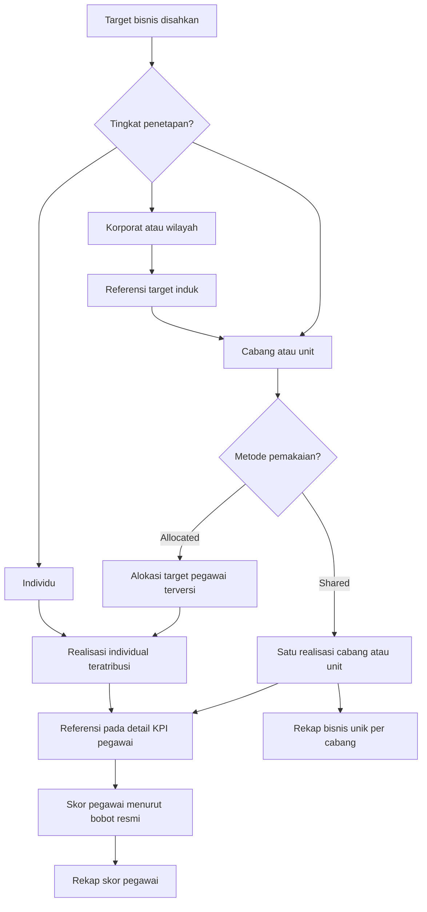

### 29.3 Kamus metrik perbankan dan kontrak penghitungan

| Kandidat metrik | Semantik | Metode data | Catatan validasi |
|---|---|---|---|
| Penyaluran/realisasi kredit baru | `flow` | Agregasi transaksi sepanjang tanggal awal-akhir triwulan | Harus jelas transaksi bruto/neto, pembatalan, dan reversal. |
| Pertumbuhan DPK | `stock_delta` atau formula custom | Selisih posisi akhir dan baseline, sesuai definisi pemilik metrik | Tidak sama dengan `SUM(saldo harian)`; tentukan cakupan produk dan cabang. |
| Baki debet kredit | `stock` | Nilai posisi tanggal cut-off | Angka akhir periode, bukan jumlah posisi bulanan. |
| NPL gross/net | `ratio` | Pembilang dan penyebut terverifikasi, dihitung untuk tanggal posisi sama | Definisikan kolektibilitas, cakupan aset dan pembulatan sebelum aktivasi. |
| Laba | `flow` atau akumulasi periode | Sesuai definisi laba dari sistem akuntansi yang ditunjuk | Pastikan basis bulan/triwulan, jurnal koreksi dan konsolidasi. |
| Jumlah nasabah baru | `count` | `distinct` berdasarkan ID nasabah dengan tanggal kejadian yang jelas | Jangan gunakan jumlah rekening apabila indikatornya jumlah nasabah. |
| Penyelesaian temuan audit | `milestone` atau `ratio` | Status item dari register temuan yang disahkan | Penutupan harus mempunyai tanggal dan bukti yang dapat ditelusuri. |
| Kualitas pelayanan | `rubric` | Self-assessment + nilai reviewer berdasarkan rubrik | Bukti dan alasan perubahan skor dicatat. |

**BR-48.** Setiap metrik memiliki `metric_definition_version` berisi pembilang/penyebut (bila rasio), batas waktu, satuan, arah nilai, pembulatan, aturan reversal, unit atribusi, dan `data_owner`. Perubahan definisi harus diuji lewat simulasi historis sebelum disahkan.

**BR-49.** Metrik `flow`, `stock`, `ratio`, dan `count` memiliki mekanisme agregasi yang berbeda. Engine menolak `SUM` untuk metrik `stock` dan menolak `AVG` sederhana atas `ratio` kecuali definisi spesifik membolehkannya.

**BR-50.** Nilai `0` dengan status data `valid` berbeda dari `null`, `not_received`, `mapping_missing`, `stale`, `invalid`, dan `reconciliation_failed`. Hanya data valid yang boleh menjadi dasar skor final; aturan skor pada target nol harus eksplisit per indikator.

### 29.4 Kalender triwulan, cut-off, dan perubahan data

**Usulan default kalender** adalah triwulan kalender (Jan-Mar, Apr-Jun, Jul-Sep, Okt-Des); ini perlu konfirmasi karena pengguna baru menetapkan durasi 3 bulan, bukan tanggal kalender resmi. Untuk setiap periode, sistem menyimpan: `measurement_start/end`, `source_cutoff_at`, `data_validation_deadline`, `self_assessment_open/deadline`, `review_deadline`, `finalization_deadline`, `locked_at`.

**Keputusan untuk pilot KCU:** jendela pengukuran memakai durasi yang sama tepat sebelum awal siklus penilaian, dan berakhir sehari sebelum siklus dimulai. Jadi siklus bulanan November mengukur realisasi 1–31 Oktober; siklus tiga bulan yang mulai November mengukur Agustus–Oktober. Tanggal siklus tetap menjadi jendela pengisian dan review. Prototype menurunkan jendela realisasi dari `starts_at` dan cadence; penyimpanan tanggal pengukuran serta cut-off sumber tetap menjadi kebutuhan lanjutan.

**BR-51.** `measurement_end` membatasi tanggal bisnis yang diukur; `source_cutoff_at` membatasi koreksi sumber yang masih dapat dipakai sebagai snapshot resmi. Keduanya adalah konsep berbeda dan tidak boleh dipertukarkan.

**BR-52.** Setelah cut-off, perubahan sumber memicu perbandingan versi dan anomaly report, bukan pemutakhiran otomatis terhadap penilaian yang sudah final. Koreksi resmi membentuk versi nilai baru lengkap dengan alasan dan approval.

**BR-53.** Periode triwulanan dapat dipantau dengan progres berjalan, tetapi progres bulanan tidak otomatis dianggap skor final; skor final menunggu data periode lengkap, quality gate, dan approval.

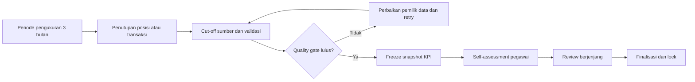

### 29.5 Penilaian pejabat, masa tugas, dan fairness

**BR-54.** Setiap subjek KPI, termasuk Kabid, Kacab, Korwil, dan Kadiv, memerlukan penilai yang bukan dirinya sendiri. Kewenangan penilai pejabat struktural harus ditetapkan secara formal dan diekspresikan sebagai konfigurasi alur yang berlaku pada tanggal efektif.

**BR-55.** Jika pegawai mutasi antarunit di tengah triwulan, nilai individual yang berbasis transaksi menggunakan atribusi tanggal kejadian; nilai unit/cabang menggunakan metode yang disetujui SDM (unit terakhir, bobot masa kerja, atau penilaian terpisah). Tidak ada prorata otomatis tanpa kebijakan.

**BR-56.** Saat pegawai menjabat PLT/rangkap, penilaian tidak boleh menggandakan peserta. Rancangan mendukung satu assessment dengan beberapa segmen tanggung jawab atau assessment berbeda hanya bila disahkan sebagai kebijakan formal.

**BR-57.** Bila belum ada reviewer valid untuk pejabat struktural, sistem boleh membentuk assessment dan memantau realisasi, tetapi harus memblokir finalisasi dan memberi status `reviewer_unresolved` dengan escalation owner yang jelas.

### 29.6 Definisi skoring yang belum boleh diputuskan developer sendiri

Parameter minimal untuk tiap indikator: `score_min`, `score_max`, `cap`, `direction`, `rounding_mode`, `decimal_precision`, `zero_target_policy`, `missing_data_policy`, `rubric_version`, `relative_weight`, `effective_at`.

**Contoh penjelasan angka yang bersifat ilustrasi, bukan kebijakan:** jika sebuah indikator `higher_is_better` memiliki target 100 dan realisasi 120, tingkat pencapaiannya 120% sebelum penerapan cap. Untuk indikator `lower_is_better` seperti rasio bermasalah, penggunaan `target / realization` tanpa aturan nol dapat menghasilkan pembagian nol; engine harus menggunakan strategi yang disahkan khusus untuk rasio tersebut. Untuk metrik laba dengan target negatif/kerugian, formula rasio standar juga tidak memadai.

Seluruh `effective_weight` pada kelompok indikator yang aktif wajib 100% setelah resolusi template, termasuk pengecualian jabatan. Kelompok tanpa indikator aktif memerlukan template kebijakan pengganti, bukan redistribusi bobot implisit oleh aplikasi.

### 29.7 Dampak terhadap ERD dan tabel yang dibutuhkan

Rancangan v2.1 memiliki periode, indikator, versi, target, realisasi, atribusi, dan assessment. Versi ini memperjelas *grain* dan constraint berikut sebagai perluasan konseptual:

| Tabel atau perluasan | Kolom kunci | Aturan inti |
|---|---|---|
| `kpi_metric_definition_versions` | `id`, `indicator_version_id`, `semantics`, `aggregation_method`, `numerator_ref`, `denominator_ref`, `source_version` | Setiap formula semantik terversi dan immutable setelah aktivasi. |
| `kpi_target_hierarchy` | `id`, `parent_target_id`, `child_target_id`, `allocation_mode`, `allocated_amount`, `policy_version` | Relasi induk-turunan tanpa menganggap semua rasio additive. |
| `kpi_source_value_snapshots` | `id`, `period_id`, `metric_version_id`, `subject_scope`, `subject_key`, `as_of_date`, `value`, `quality_status`, `source_run_id` | Satu nilai kanonis per grain dan versi; dibagikan ke banyak item KPI. |
| `kpi_data_quality_findings` | `id`, `source_run_id`, `metric_version_id`, `finding_code`, `severity`, `resolution`, `resolved_by`, `resolved_at` | Pemisahan error teknis dan exception yang sudah diotorisasi. |
| `kpi_assessment_item_sources` (perluasan) | `source_snapshot_id`, `attribution_policy_version`, `applied_fraction`, `score_input_value` | Merekam asal data dan bobot atribusi per item KPI pegawai. |

**Kunci kandidat:** `UNIQUE(period_id, metric_version_id, subject_scope, subject_key, as_of_date, source_run_id)` pada snapshot sumber; foreign key `assessment_item_sources.source_snapshot_id` ke snapshot sumber; kontrol jangan memiliki dua target allocation aktif untuk pegawai, indikator, dan periode yang sama tanpa versi supersession. Secara implementasi, kunci uniqueness harus memperhitungkan bahwa nilai source dapat dihitung ulang dalam run berbeda, tetapi hanya satu snapshot resmi boleh `is_current=true` per grain.

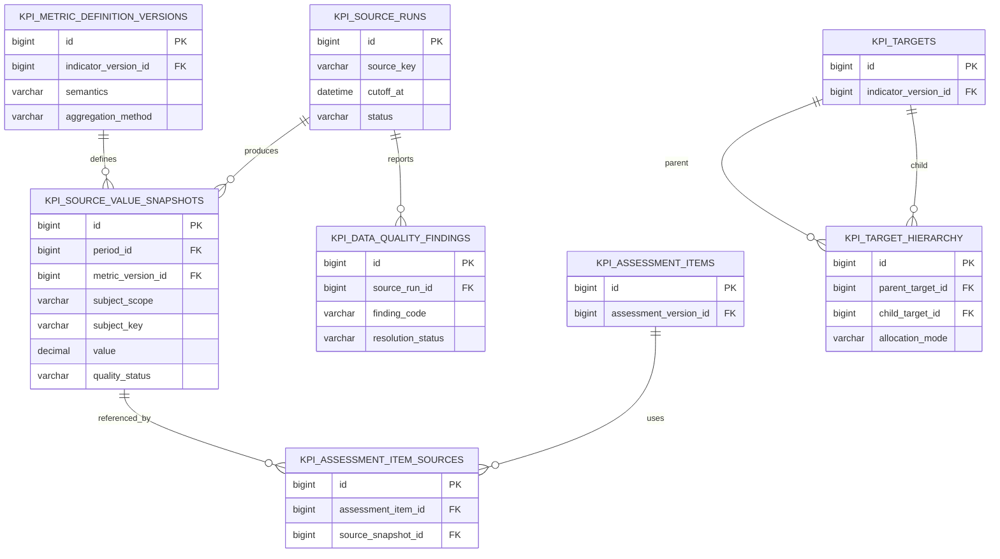

### 29.8 Acceptance criteria tambahan / UAT terukur

| UAT | Kasus | Expected result |
|---|---|---|
| UAT-43 | KPI kredit baru dengan transaksi per triwulan | Menjumlahkan transaksi valid sesuai definisi, bukan saldo stok. |
| UAT-44 | KPI baki debet dengan tiga snapshot bulan | Mengambil nilai posisi akhir yang disahkan, bukan menjumlahkan tiga saldo. |
| UAT-45 | NPL per cabang dihitung dari beberapa periode | Menggunakan pembilang/penyebut satu basis tanggal, bukan AVG persen sembarang. |
| UAT-46 | DPK satu cabang dipakai tiga pegawai | Nilai realisasi bisnis pada dashboard konsolidasi tetap satu kali. |
| UAT-47 | Alokasi target empat AO lebih besar dari target induk | Aktivasi alokasi ditolak sampai rekonsiliasi atau override berwenang. |
| UAT-48 | Cabang tidak memiliki AO dengan mapping valid | Item pegawai `mapping_missing`; tidak otomatis realisasi 0. |
| UAT-49 | Sumber gagal tetapi nilai lama masih ada | Data baru berstatus stale/pending, dan freeze menolak nilai tak valid. |
| UAT-50 | Mutasi pegawai pada bulan kedua | Riwayat dua segmen tetap ada; atribusi mengikuti aturan yang disahkan. |
| UAT-51 | Kacab belum memiliki reviewer final | Penilaian tetap tercatat; finalisasi diblokir `reviewer_unresolved`. |
| UAT-52 | Formula berubah pada triwulan berikutnya | Periode lama tetap menggunakan definisi dan snapshot formula lama. |
| UAT-53 | Pengguna menimpa nilai sumber KPI via API | Backend menolak; log keamanan terekam. |
| UAT-54 | Source re-run setelah penilaian final | Hasil akhir tidak berubah; koreksi mengeluarkan versi penilaian baru. |

### 29.9 Keputusan yang dibutuhkan untuk penguncian desain berikutnya

| Prioritas | Topik yang harus diputuskan | Opsi atau catatan |
|---|---|---|
| P0 | Pemetaan Direktur bidang dan pejabat definitif | Jalur ke Direksi sudah dikonfirmasi v2.3; nama orang, lingkup direktorat, dan mandat kekosongan tetap memerlukan verifikasi. |
| P0 | Indikator bersama cabang | Diberikan kepada semua pegawai atau hanya peran terpilih; konfigurasi per kelompok jabatan. |
| P0 | Bobot 3 komponen | Individual, unit/cabang, kualitatif per kelompok jabatan. |
| P0 | Triwulan kalender dan cut-off | Kalender Jan-Mar dst. atau bergeser; tanggal pembekuan data. |
| P1 | Perlakuan mutasi/PLT di tengah periode | Unit akhir, segmentasi masa tugas, atau assessment terpisah. |
| P1 | Data owner dan sumber definitif | MONBIS, core banking, SIMPEG, akuntansi, dan register operasional sesuai metrik. |
| P1 | Mekanisme keberatan | Siapa memeriksa, SLA, bukti, versi koreksi, dan hak akses. |

**Gate desain:** DDL MySQL produksi dan implementasi engine nilai akhir baru dapat dikunci setelah pemilik proses menyetujui penilai pejabat, definisi KPI, bobot, treatment target 0, dan atribusi individu-cabang. Desain tabel dan prototype tanpa aktivasi nilai akhir dapat dibuat sebelumnya.


## 30. Struktur Direksi, resolver penilai berbasis bidang, dan otorisasi (v2.3)

### 30.1 Keputusan desain dan ruang lingkup

| Kode | Ketentuan | Status / batasan |
|---|---|---|
| DEC-04 | KPI Kacab dinilai Korwil lalu disetujui Direktur yang membawahi bidang terkait | Dikonfirmasi pengusul; rincian direktorat pemilik per unit perlu dipetakan dan disahkan |
| DEC-05 | KPI Korwil dan Kadiv dinilai sekaligus difinalisasi oleh Direktur yang membawahi bidangnya | Dikonfirmasi pengusul; setiap penilaian hanya satu tahap Direksi kecuali ditetapkan lain |
| DEC-06 | Jabatan Direktur Pemasaran ada tetapi sementara tidak memiliki pejabat definitif | Dikonfirmasi pengusul; jangan membuat akun, orang penilai, atau fallback otomatis |
| DEC-07 | Direktur Kepatuhan dan jabatan Direktur lainnya diakomodasi dalam master direktorat | Nama formal, kode jabatan, pemegang jabatan, dan cakupan bidang wajib diverifikasi di SIMPEG/SDM |

Keputusan di atas mengganti **hanya** bagian rancangan sebelumnya yang menandai reviewer Kacab, Korwil, dan Kadiv sebagai belum diketahui. Implementasi tetap membutuhkan identitas pejabat Direktur, peta bidang tanggung jawab, serta bukti penunjukan yang berlaku. Persetujuan kebijakan KPI dan struktur resmi manajemen tetap menjadi gate go-live.

**Prinsip domain:** `directorate` adalah posisi/fungsi yang bertanggung jawab; `reviewer` adalah orang (`id_peg`) yang memiliki kewenangan efektif. Posisi dapat tetap ada saat kosong; referensi orang tidak boleh direkayasa. Simpan nama jabatan yang diberikan pengguna apa adanya sampai diverifikasi; jangan menafsirkan sebutan umum 'Direktur' sebagai 'Direktur Utama'.

### 30.2 Matriks workflow terpadu

| Peserta KPI | Step 1 | Step 2 / final | Status konfigurasi |
|---|---|---|---|
| Staf KC/KK | Kabid bidang terkait | Kacab | Baseline, validasi pemetaan bidang dan pejabat aktif |
| Kabid KC | Kacab | Belum diputuskan apakah perlu step tambahan | Keputusan SDM masih terbuka |
| Kacab | Korwil wilayah penugasan | Direktur berdasarkan scope bidang yang ditetapkan | Jalur dikonfirmasi; direktorat dan orang di-resolve per periode |
| Staf KW | Korwil | Tidak ada | Baseline, validasi penugasan wilayah |
| Korwil | Direktur sesuai bidang | Tidak ada | Satu step yang sekaligus final |
| Staf KP | Kabid | Kadiv | Baseline, validasi struktur divisi |
| Kabid KP | Kadiv | Belum diputuskan apakah perlu step tambahan | Keputusan SDM masih terbuka |
| Kadiv KP | Direktur sesuai bidang | Tidak ada | Satu step yang sekaligus final |
| Anggota Direksi sebagai subjek KPI | Belum ditetapkan | Belum ditetapkan | Tidak dibuatkan alur penilaian Direksi otomatis |

**BR-58.** Kacab melalui urutan `Korwil -> Direktur sesuai bidang -> finalisasi`, tanpa melewati salah satu approval.

**BR-59.** Korwil melalui satu step Direksi; reviewer Direksi memberi nilai, catatan dan keputusan final pada step tersebut.

**BR-60.** Kadiv melalui satu step Direksi dengan prinsip yang sama; Direksi tidak menerima default akses lintas seluruh divisi.

**BR-61.** Penilai akhir Direksi dipilih dari hubungan bidang/unit/jabatan yang disahkan, bukan dari kata pada nama jabatan, senioritas, atau direktur yang kebetulan sedang login.

### 30.3 Mekanisme pemetaan direktorat dan resolusi

Bentuk konfigurasi yang diusulkan: `subject_role_scope + unit_kerja + kode_cabang/wilayah + tanggal_efektif + rule_version -> directorate_id -> incumbent_id_peg / mandate_id -> reviewer yang sah`.

Urutan resolusi (tidak boleh menghasilkan fallback tanpa kewenangan):

1. Ambil assessment, versi periode, snapshot jabatan subjek, unit, cabang/wilayah, dan workflow step yang membutuhkan Direksi.
2. Cocokkan aturan cakupan direktorat yang telah disetujui serta tanggal efektif. Bila nol atau lebih dari satu aturan teratas cocok, tandai `scope_unresolved` atau `scope_conflict`.
3. Resolve posisi Direktur yang bertanggung jawab; identifikasi penugasan pejabat aktif dari SIMPEG/mandat resmi yang terverifikasi.
4. Jika posisi Direktur Pemasaran kosong, catat `position_vacant`; cari **hanya** mandat PLT/delegasi yang telah disahkan dan mencakup step, unit, periode dan jenis tindakan tersebut.
5. Bila tidak ada mandat valid, status step `reviewer_unresolved` dan finalisasi **diblokir**. Self-assessment, pengambilan realisasi dan review Korwil yang sudah sah dapat tetap berjalan.
6. Validasi aktor bukan subjek yang dinilai, tidak melewati masa mandat, tidak melanggar scope, tidak mengambil keputusan dua kali, dan tidak sedang bertindak melalui konflik kepentingan yang tidak diizinkan.
7. Simpan pemilihan reviewer, sumber rule, sumber mandat, snapshot jabatan/identitas, waktu resolusi, serta alasan/kode keputusan dalam audit.

**BR-62.** Jika posisi kosong, kandidat reviewer tidak boleh diisi `id_peg` fiktif, akun 'Direksi bersama', atau admin KPI.

**BR-63.** Persetujuan delegasi dan PLT mensyaratkan dokumen mandat/otorisasi, penerbit, cakupan jabatan dan unit, hak tindakan, tanggal mulai-akhir dan status validasi. Penugasan tidak berlaku surut pada keputusan lama.

**BR-64.** Penugasan Direktur Pemasaran yang kosong tidak otomatis dialihkan kepada Direktur Kepatuhan atau direktur lain. Pelimpahan hanya berlaku setelah mandat resmi dan otorisasi di sistem.

**BR-65.** Rule pemetaan direktorat yang berubah di tengah triwulan tidak boleh memindah persetujuan secara senyap. Step yang belum diputuskan dapat dialihkan melalui proses re-assignment terotorisasi dan histori tetap utuh.

**BR-66.** Bila dua pejabat/mandat sama-sama aktif pada scope dan waktu yang sama, status `authority_conflict` memblokir approval sampai pemilik proses menyelesaikan konflik.

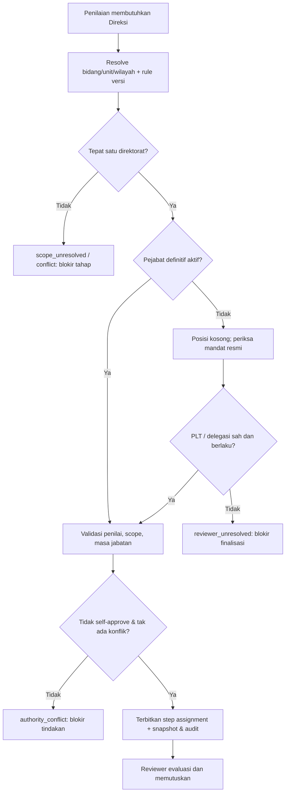

### 30.4 Hak akses dan separation of duties

| Aksi | Pegawai | Korwil penilai Kacab | Direktur ter-assign | Admin KPI/SDM | TI/superadmin |
|---|---|---|---|---|---|
| Lihat KPI pribadi | Milik sendiri | Milik sendiri | Milik sendiri bila peserta | Sesuai mandate kerja | Bukan hak otomatis |
| Lihat KPI Kacab/Korwil/Kadiv lain | Tidak | Kacab pada wilayahnya dan step-nya | Hanya unit/bidang dan objek yang menjadi kewenangannya | Hanya sesuai kebutuhan proses | Tidak otomatis |
| Tulis self-assessment | Milik sendiri | Milik sendiri | Milik sendiri | Tidak | Tidak |
| Review KPI Kacab | Tidak | Saat step 1 aktif | Saat step Direksi aktif | Tidak | Tidak |
| Final KPI Kacab | Tidak | Tidak | Saat penilai final aktif dan valid | Tidak | Tidak |
| Final KPI Korwil/Kadiv | Tidak | Tidak | Saat step Direksi aktif dan valid | Tidak | Tidak |
| Usulkan perubahan peta direktorat | Tidak | Dapat memberi masukan | Dapat mengusulkan sesuai tugas | Ya | Implementasi teknis |
| Sahkan peta/delegasi kewenangan | Tidak | Tidak | Hanya jika punya wewenang dan bukan penerima manfaat | Fasilitasi, bukan sahkan sendiri | Tidak |
| Baca audit approval | Riwayat sendiri | Objek step-nya | Objek kewenangannya | Sesuai audit dan kontrol internal | Log operasional saja |

**BR-67.** Kontrol otorisasi memakai kombinasi RBAC + ABAC pada backend (`actor_id`, izin aksi, `assessment_id`, `workflow_step_instance_id`, `directorate_id`, `effective_at`, `mandate_id`, kantor/unit, dan status). UI yang menyembunyikan tombol bukan kontrol keamanan.

**BR-68.** Role `director` saja tidak memberikan hak seluruh laporan perusahaan. Seorang Direktur hanya menerima item dan rekap dalam scope yang disahkan, kecuali ada hak viewer lintas unit yang secara terpisah diberikan.

**BR-69.** Setiap keputusan memvalidasi reviewer pada **server side** saat transaksi, tidak hanya ketika inbox dibuat. Penugasan yang kadaluarsa tidak dapat digunakan untuk approval meskipun halaman lama masih terbuka.

**BR-70.** Pembuat/pengusul mandat tidak boleh menyetujui mandatnya sendiri jika itu memberikan kewenangan approval kepadanya; kontrol maker-checker wajib tersedia.

**BR-71.** Setiap keputusan `approve`, `return`, `reject`, `reassign`, dan `finalize` harus tercatat append-only dengan waktu, identitas aktor, sumber kewenangan, komentar, serta correlation/request ID untuk mencegah eksekusi ulang.

### 30.5 State dan alur operasional jika Direktur Pemasaran kosong

Contoh konseptual: KPI Kacab telah dinilai Korwil, tetapi step final terpetakan ke Direktur Pemasaran yang belum memiliki pejabat definitif.

1. Korwil menyelesaikan review (jika mandat Korwil valid); aplikasi menandai step 1 `approved`.
2. Sistem membuat step final dengan `directorate_id=PEMASARAN`, `reviewer_employee_external_id=NULL`, dan status `reviewer_unresolved / position_vacant`.
3. Pegawai dan Admin KPI melihat status menunggu penetapan penilai Direksi. Data kuantitatif, catatan Korwil, dan bukti tetap tersimpan.
4. Admin KPI dapat mengajukan penugasan PLT/delegasi dengan SK/mandat resmi; pengguna pemberi otorisasi berbeda dari pengusul/penerima kewenangan.
5. Setelah disahkan, resolver memvalidasi scope dan tanggal; step yang belum diputuskan mendapat assignment baru dengan jejak asal.
6. Direktur/PLT yang sah meninjau data, memutuskan, dan sistem mengunci nilai bila semua quality gate terpenuhi.

**BR-72.** Kekosongan jabatan boleh menyebabkan keterlambatan yang tercatat, tetapi tidak mengizinkan approval tanpa aktor sah atau finalisasi otomatis karena deadline terlewati.

**BR-73.** Satu step yang ditunda karena kekosongan harus muncul pada dashboard anomali dan laporan ketepatan waktu, dengan identitas post dan penyebab; jangan memberi penilaian buruk kepada pegawai semata karena jabatan reviewer kosong.

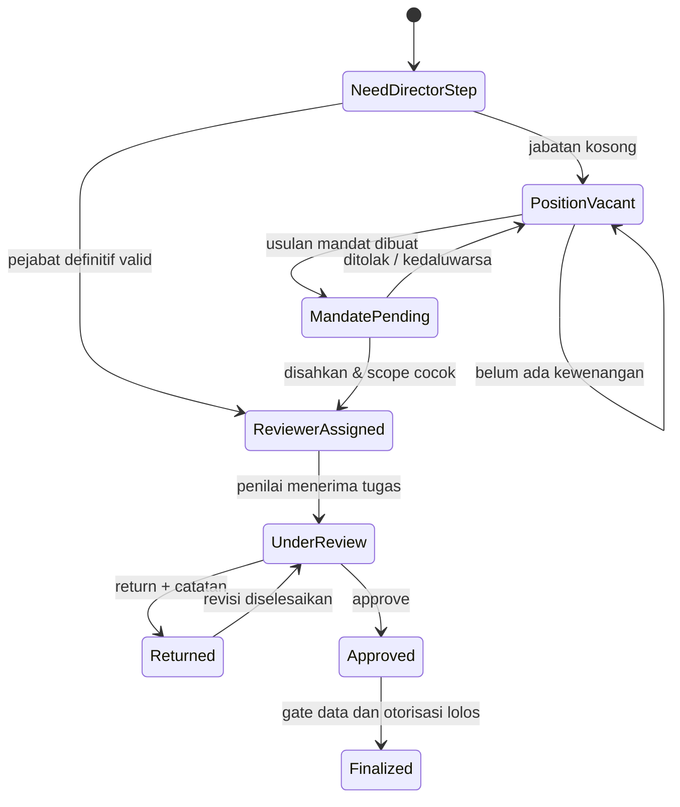

### 30.6 Perluasan ERD dan constraint implementasi

Gunakan entitas berikut sebagai tambahan dari tabel existing v2.2 (bukan mengganti tabel penilaian lama).

| Tabel baru / perluasan | Kolom dan relasi utama | Aturan utama |
|---|---|---|
| `kpi_directorates` | `id`, `code`, `formal_title`, `effective_from/to`, `is_active` | Posisi/fungsi Direksi tetap ada meskipun kosong; `code` unik |
| `kpi_directorate_scope_rules` | `id`, `directorate_id`, `subject_job_group`, `subject_unit_code`, `subject_office_scope`, `subject_region_code`, `priority`, `effective_from/to`, `status`, `approved_by/at` | Semua scope dan prioritas terversi; overlap aturan dengan prioritas identik ditolak/diflag |
| `kpi_directorate_occupancy_snapshots` | `id`, `directorate_id`, `employee_external_id` nullable, `source_assignment_ref`, `effective_as_of`, `occupancy_status`, `source_synced_at` | Referensi posisi dan data jabatan SIMPEG; tidak mengarang pejabat yang tidak ada |
| `kpi_authority_mandates` | `id`, `directorate_id`, `delegate_employee_external_id`, `mandate_type`, `permissions_json`, `scope_json`, `valid_from/to`, `decree_ref`, `requested_by`, `approved_by/at`, `status` | Tidak aktif tanpa persetujuan; tolak mandat yang melanggar separation-of-duties |
| `kpi_reviewer_resolution_runs` | `id`, `step_instance_id`, `rule_id` nullable, `occupancy_snapshot_id` nullable, `mandate_id` nullable, `resolved_employee_external_id` nullable, `result_code`, `reason_code`, `resolved_at` | Jejak setiap upaya penentuan penilai; status dapat `position_vacant`, `resolved`, `conflict` |
| `kpi_workflow_step_instances` (perluasan) | tambah `directorate_id`, `resolution_run_id`, `authority_mandate_id`, `assignment_status`, `assigned_at` | FK internal, null reviewer diperbolehkan hanya jika unresolved; immutable setelah keputusan, kecuali melalui versi/reassignment |

**Usulan constraint:** indeks `(directorate_id, effective_from, effective_to)` pada rule dan occupancy; `(delegate_employee_external_id, status, valid_from, valid_to)` untuk mandat; `(step_instance_id, resolved_at)` pada resolution run; `(reviewer_employee_external_id, status, due_at)` tetap dipakai inbox. Foreign key ke SIMPEG di DB berbeda diperlakukan logical reference. Validasi temporal overlap dan tepat-satu penugasan memakai layanan/aplikasi dalam transaksi (MySQL unique sederhana tidak cukup untuk mencegah overlap range tanggal).

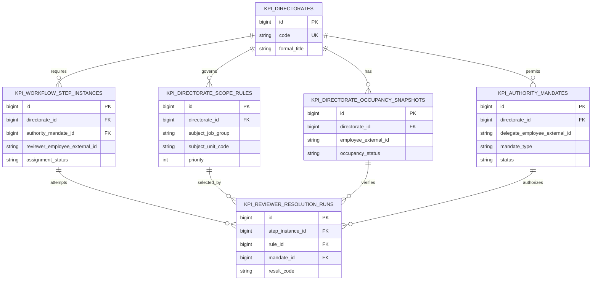

### 30.7 API kontrak dan validasi backend

| Metode / endpoint kandidat | Wewenang | Guard utama |
|---|---|---|
| `GET /api/kpi/my-review-tasks` | Penilai login | Filter reviewer aktif, tanggal mandat dan ABAC scope |
| `GET /api/kpi/directorates` | Admin KPI/SDM dan viewer terotorisasi | Tidak mengekspos data di luar scope |
| `POST /api/kpi/directorate-scopes/validate` | Admin KPI usulkan | Simulasikan rule overlap, vacancy, dan self-approval |
| `POST /api/kpi/reviewer-resolutions/run` | Admin KPI/scheduler berizin | Idempotency key, tidak langsung menyetujui |
| `POST /api/kpi/authority-mandates` | Pengusul berizin | Validasi dasar SK, scope, masa berlaku, dan penerima mandat |
| `POST /api/kpi/authority-mandates/{id}/approve` | Pengesah kewenangan terpisah | Maker-checker dan dokumen sah; tolak self-approval |
| `POST /api/kpi/reviews/{stepId}/decision` | Reviewer aktif pada step | State, scope, reviewer_id, mandat, anti replay, audit atomik |
| `GET /api/kpi/exceptions/reviewer-unresolved` | Admin KPI/SDM sesuai scope | Lihat penyebab, umur kasus, dan tindakan resolusi |

**BR-74.** Semua endpoint tulis menerapkan optimistic-locking atau row lock dan event idempotency; dua reviewer tidak boleh sekaligus menyelesaikan satu step.

**BR-75.** Error 403 untuk aktor tidak berwenang, 409 untuk konflik state/otorisasi yang berubah, dan 422 untuk permintaan dengan konfigurasi/data tidak lengkap. Jangan mengembalikan informasi internal sensitif yang tidak berhak dilihat.

### 30.8 UAT tambahan dan hasil yang diharapkan

| UAT | Skenario | Expected result |
|---|---|---|
| UAT-55 | Kacab submit KPI, Korwil punya scope valid | Step 1 masuk inbox Korwil terkait, bukan Korwil lain |
| UAT-56 | Korwil approve KPI Kacab | Step Direksi aktif dengan jalur direktorat sesuai rule sah |
| UAT-57 | Direktur Pemasaran kosong, Kacab terpetakan ke sana | Step akhir `reviewer_unresolved`; tidak ada reviewer fiktif; finalisasi diblokir |
| UAT-58 | Admin KPI mencoba approve atas nama Direktur yang kosong | Ditolak 403 dan security event tercatat |
| UAT-59 | Mandat PLT diterbitkan tetapi belum disahkan | Tidak memberi akses review/approve |
| UAT-60 | Mandat PLT sah dan sesuai scope/tanggal | Step dapat di-assign, aktor sah masuk inbox, sumber mandat dapat ditelusuri |
| UAT-61 | Mandat telah kadaluarsa saat tombol approve ditekan | Aksi ditolak; reviewer harus di-resolve ulang |
| UAT-62 | Dua aturan direktorat sama-sama cocok dan berprioritas sama | `scope_conflict`; tidak memilih acak |
| UAT-63 | Direktur Kepatuhan membuka penilaian yang hanya di bawah direktorat lain | Ditolak 403 meskipun aktor mempunyai role Direktur |
| UAT-64 | Penilai meninjau KPI sendiri dalam rangkap jabatan | Self-approval diblokir dan dicatat |
| UAT-65 | Korwil submit KPI miliknya | Tepat satu step Direksi; tidak masuk review Korwil itu sendiri |
| UAT-66 | Kadiv submit KPI miliknya | Tepat satu step Direksi sesuai bidang |
| UAT-67 | Direktorat berubah setelah step Korwil selesai | Review Korwil historis tetap; step Direksi perlu prosedur reassign dengan audit |
| UAT-68 | Reviewer melakukan double-click approve | Hanya satu keputusan dan satu transisi status tersimpan |
| UAT-69 | Mandat dibuat oleh aktor yang ingin menjadi penerima, lalu menyetujui sendiri | Maker-checker menolak |
| UAT-70 | Kacab terdampak kekosongan reviewer melewati deadline | Laporan anomali menandai penyebab jabatan kosong, tanpa menghitung pegawai otomatis gagal KPI |

### 30.9 Hal yang masih memerlukan konfirmasi

| Prioritas | Pertanyaan / keputusan | Pengaruh implementasi |
|---|---|---|
| P0 | Apa nama dan kode **jabatan Direktur ketiga** yang disebut sebagai 'Direktur'? | Master direktorat dan mapping valid |
| P0 | Direktur mana membawahi **Kacab, Korwil, dan setiap Kadiv**? Termasuk apakah satu jabatan punya lebih dari satu domain | Matriks scope final; jangan diasumsikan dari nama jabatan |
| P0 | Siapa yang berwenang menerbitkan/mengesahkan PLT/delegasi untuk Direktur Pemasaran yang kosong? | Alur maker-checker dan mandat |
| P0 | Adakah mandat aktif saat ini untuk tugas Direktur Pemasaran? | Boleh/tidaknya approval final pada periode pertama |
| P1 | Apakah Kabid KC cukup final di Kacab, dan Kabid KP cukup final di Kadiv? | Penyelesaian workflow menengah |
| P1 | Apakah penilaian terhadap anggota Direksi sendiri termasuk aplikasi? | Scope peserta level tertinggi |
| P1 | Kapan aturan peta Direksi berlaku (triwulan berjalan atau berikutnya), dan siapa pengesahnya? | Versioning, re-assignment dan prosedur cut-over |

**Keputusan teknis aman sambil menunggu konfirmasi:** tambah master jabatan Direksi dan posisi Direktur Pemasaran kosong, buat resolver yang mendukung `vacant`, serta tampilkan assessment tertunda di dashboard. Jangan membuat data dummy pegang jabatan, default director id, atau menyetujui otomatis. Implementasi finalisasi untuk kasus yang memerlukan Direktur Pemasaran baru aktif setelah pejabat/mandat sah tersedia.


## 31. Spesifikasi rinci approval Direksi dan kontrol akses - revisi implementasi v2.3

### 31.1 Baseline keputusan dan batas kepastian

**Sudah disepakati:** peserta KPI meliputi seluruh pegawai dan pejabat struktural; periode penilaian triwulan; komponen bisnis menggabungkan kinerja individu dan cabang/unit; Kacab dinilai Korwil lalu Direksi; Korwil dan Kadiv dinilai satu tahap oleh Direksi; penilai Direksi dipilih berdasarkan bidang yang membawahi peserta. Posisi Direktur Pemasaran saat ini dinyatakan kosong sementara, namun jabatan tetap ada dalam master.

**Masih memerlukan penetapan formal:** peta setiap cabang/wilayah/divisi terhadap direktorat; nama dan kode jabatan Direktur selain yang sudah disebut; pemegang jabatan aktual; surat mandat aktif ketika Direktur Pemasaran kosong; pengesah mandat; alur Kabid KC dan Kabid KP; apakah anggota Direksi sendiri masuk objek penilaian di aplikasi. Rancangan di bawah ini bersifat spesifikasi implementasi yang *belum* mengesahkan hal-hal tersebut.

| Domain | Sumber acuan | Aturan saat data tidak lengkap |
|---|---|---|
| Jabatan, pegawai, kantor, tanggal efektif | SIMPEG (`tb_jabatan`, `tb_master_jabatan`, `tb_kantor`) | Masuk exception queue; tidak menebak jabatan aktif |
| Pemetaan jabatan/unit ke direktorat | Matriks kewenangan terversi yang disahkan pejabat berwenang | `scope_unresolved`, approval tertahan |
| Pemegang jabatan Direktur | Jabatan aktif dalam SIMPEG, dicocokkan ke posisi direktorat | `position_vacant` jika tidak ada pemegang yang valid |
| Pengganti / PLT / delegasi | Penugasan resmi dengan waktu, cakupan, hak, dan bukti | `mandate_pending` / `reviewer_unresolved` jika tidak sah |
| Skor KPI dan realisasi | Snapshot indikator, bobot, realisasi dan tanggal data | Gagal final jika quality gate belum terpenuhi |

### 31.2 Decision table untuk penentuan reviewer

| Peserta & kondisi | Step reviewer | Aksi sistem | Yang tidak boleh dilakukan |
|---|---|---|---|
| Kacab, Korwil wilayah aktif dan direktorat resolvable | Korwil lalu Direktur yang ditunjuk | Buat 2 step berurutan; step 2 baru aktif setelah step 1 selesai | Menjalankan step 2 sebelum review Korwil sah |
| Korwil, bidang ke direktorat tepat satu | Direktur yang ditunjuk (final) | Buat satu step Direksi | Memasukkan Korwil sebagai reviewer KPI dirinya |
| Kadiv, bidang ke direktorat tepat satu | Direktur yang ditunjuk (final) | Buat satu step Direksi | Menetapkan semua Direktur sebagai reviewer global |
| Direktur Pemasaran kosong; mandat tidak ada | Step Direksi unresolved | Simpan review sebelumnya, tandai `position_vacant`, masukkan anomali | Fallback otomatis ke Direktur Kepatuhan / pejabat lain |
| Mandat PLT sah dan mencakup tugas, periode, organisasi | Direktur/pejabat dengan mandat valid | Bind reviewer dengan `authority_mandate_id` dan audit | Memberi akses di luar lingkup mandat |
| Dua aturan sama-sama cocok di level prioritas setara | Belum ada reviewer | Blokir dan tampilkan `scope_conflict` | Memilih aturan secara acak |
| Pegawai penilai sama dengan peserta | Belum ada reviewer | Blokir `self_approval` dan eskalasi pengaturan | Melewati larangan karena rangkap jabatan |

### 31.3 Resolver direktorat - algoritme deterministik

Resolver **tidak boleh mengandalkan nama jabatan seperti 'Pemasaran' sebagai substring**. Ia menggunakan `job_code`, `unit_code`, `branch_code`, `region_code`, jabatan efektif, serta versi matriks kewenangan yang telah disahkan.

1. Tentukan snapshot subjek penilaian dan organisasi untuk triwulan tersebut. Bila terdapat mutasi dan segmentasi periode, terapkan aturan snapshot/segmen yang telah disahkan.
2. Pilih aturan direktorat berstatus `approved` yang efektif untuk konteks assessment dan sesuai jabatan/unit/wilayah. Terapkan prioritas eksplisit, bukan urutan baris SQL.
3. Jika nol aturan cocok: hasil `scope_unresolved`. Jika dua atau lebih aturan terbaik memiliki prioritas yang sama: `scope_conflict`. Keduanya menghentikan penugasan.
4. Bila tepat satu direktorat ditemukan, cari pejabat definitif aktif pada saat penugasan. Bila tidak ada, tandai `position_vacant` dan evaluasi mandat pengganti yang valid.
5. Mandat hanya valid jika status `approved`, waktu efektif mencakup waktu tindakan, aksi `review_approve` diizinkan, unit dan jabatan subjek tercakup, dan penugasan tidak melanggar separation of duties.
6. Jika tepat satu aktor sah, buat `kpi_workflow_step_instance` dengan `reviewer_employee_id`, versi aturan, sumber otorisasi dan `resolved_at`. Jika tidak, simpan step unresolved dan alasan.
7. Saat reviewer menekan Approve/Return, **ulangi pengecekan otorisasi dalam transaksi database**, karena mandat dapat kedaluwarsa setelah inbox dibuat.
8. Bila struktur berubah setelah suatu step diputuskan, pertahankan histori immutable; hanya step terbuka yang boleh direassign melalui perintah terotorisasi dan audit.

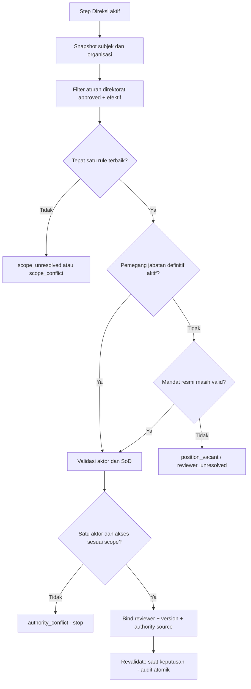

### 31.4 Siklus hidup penilaian Kacab (detail operasional)

| Tahap | Status assessment / step | Pelaku | Validasi & hasil |
|---|---|---|---|
| 1. Buka periode | `self_assessment` | Admin KPI, sistem | Template, indikator, bobot dan sumber data tervalidasi |
| 2. Isi self-assessment | `draft` -> `submitted` | Kacab | Self-assessment lengkap; realisasi kuantitatif bersumber dan dapat ditelusuri |
| 3. Review Korwil | `in_review` | Korwil sesuai wilayah | Evaluasi, catatan, justifikasi; dapat return dengan alasan |
| 4. Korwil approve | step-1 `approved` | Korwil | Atomic commit; step-2 Direksi diaktifkan |
| 5. Resolve Direksi | `reviewer_assigned` / `reviewer_unresolved` | Sistem | Direktur berdasarkan bidang, bukan pilihan bebas pengguna |
| 6. Direktur review | `in_review_final` | Penilai Direksi valid | Hanya dapat membaca dan memutuskan dalam scope-nya |
| 7. Finalisasi | `finalized` | Sistem setelah approval Direksi | Nilai, versi formula, data sumber, keputusan dan audit terkunci |
| 8. Koreksi jika diperlukan | versi koreksi terpisah | Pemegang otoritas sesuai SOP | Jangan melakukan `UPDATE` diam-diam terhadap hasil final |

**Aturan waktu:** penilai final yang baru ditunjuk setelah deadline boleh menerima tugas melalui mekanisme penanganan exception, bukan otomatis menurunkan nilai subjek. SLA penanganan jabatan kosong harus ditentukan oleh pemilik proses.

### 31.5 Matriks hak akses final yang direkomendasikan

Kode: `Y` = berhak dengan scope; `S` = hanya diri sendiri; `A` = hanya pada step yang ter-assign; `-` = tidak berhak. Setiap izin tetap diperiksa di backend dan dibatasi status, waktu, serta klasifikasi data.

| Aksi | Pegawai | Kabid/Kacab/Korwil/Kadiv reviewer | Direktur reviewer | Admin KPI | SDM/pejabat mandat | Audit internal | Admin TI |
|---|---|---|---|---|---|---|---|
| Melihat KPI diri | S | S | S | - | - | - | - |
| Isi self-assessment | S | S | S | - | - | - | - |
| Melihat KPI untuk review | - | A | A | Y (proses sesuai kebutuhan) | Y (otoritas sesuai kebutuhan) | Y (read-only) | - |
| Approve / Return step | - | A | A | - | - | - | - |
| Finalisasi penilaian | - | A bila final step | A bila final step | - | - | - | - |
| Ubah konfigurasi indikator / target | - | - | - | Y (usulan/operasi) | Sesuai mandat terpisah | - | - |
| Atur peta direktorat | - | - | - | Y (usulan) | Y (persetujuan kewenangan) | Y (read-only) | - |
| Terbitkan / sahkan mandat | - | - | - | - | Y (maker-checker) | Y (read-only) | - |
| Melihat laporan lintas wilayah | - | Y hanya lingkup sah | Y hanya bidang sah | Sesuai tugas terotorisasi | Sesuai tugas | Sesuai rencana audit | - |
| Kelola infrastruktur / user teknis | - | - | - | - | - | - | Y (tanpa hak nilai) |

Untuk pemegang **dua jabatan**, sistem menentukan konteks yang sedang dijalankan (`acting_as`) dan tetap menerapkan konflik kepentingan terhadap identitas orang (`actor_id`), bukan semata role. Contoh: Korwil yang merangkap Kacab tidak boleh menyetujui KPI dirinya saat bertindak sebagai Korwil; sistem meminta reassignment formal.

### 31.6 Kontrol akses data dan dokumen

- **Row-level scope**: query inbox/laporan harus menyertakan subjek yang di-assign, wilayah/cabang/divisi dan status step. Tidak ada endpoint daftar seluruh assessment untuk role Direktur secara default.
- **Field-level privacy**: reviewer hanya melihat indikator, skor, bukti yang relevan. Data nasabah rinci dan nomor rekening tidak otomatis ditampilkan hanya karena indikator KPI bersumber dari MONBIS/Core Banking.
- **Evidentiary documents**: berkas SK, mandat atau bukti assessment harus menggunakan private storage, izin unduh dengan pemeriksaan ulang, serta audit akses. Tidak menggunakan URL publik permanen.
- **Notification minimization**: notifikasi cukup berisi identitas tugas, status dan tautan ke inbox; rincian data sensitif tidak dimasukkan ke email/push notification.
- **Audit separation**: Admin TI dapat memantau job dan error tanpa memperoleh izin mengedit/melihat isi penilaian personal; akses break-glass harus terpisah, dibatasi waktu, dan dicatat.

```mermaid
flowchart TD
  A[Aktor minta aksi approve / view] --> B{Role mengizinkan aksi?}
  B -- Tidak --> X[403 Forbidden]
  B -- Ya --> C{Assessment ada dalam scope aktor?}
  C -- Tidak --> X
  C -- Ya --> D{Step aktif dan di-assign?}
  D -- Tidak --> Y[409 Conflict atau 403]
  D -- Ya --> E{Mandat / jabatan berlaku saat aksi?}
  E -- Tidak --> Y
  E -- Ya --> F{Bukan penilaian diri sendiri?}
  F -- Tidak --> X
  F -- Ya --> G[Transaksi simpan keputusan dan audit]
```

### 31.7 Penambahan detail model data ERD

**Gunakan kembali tabel v2.3**, tanpa menduplikasi master SIMPEG. Rancangan berikut memperjelas relasi runtime dan kolom penting untuk implementasi.

| Tabel | Kunci & atribut kritis | Constraint penting |
|---|---|---|
| `kpi_directorate_scope_rules` | `id`, `directorate_id`, `subject_job_group`, `subject_unit_code`, `subject_region_code`, `priority`, `effective_from`, `effective_to`, `status`, `version` | Rule aktif tidak overlap ambigu; setiap rule terbit harus disahkan |
| `kpi_directorate_occupancy_snapshots` | `id`, `directorate_id`, `employee_external_id` nullable, `occupancy_status`, `effective_as_of`, `source_synced_at` | Posisi kosong disimpan sebagai status, tidak diisi pegawai fiktif |
| `kpi_authority_mandates` | `id`, `directorate_id`, `delegate_employee_external_id`, `scope_json`, `permissions_json`, `valid_from`, `valid_to`, `decree_ref`, `requested_by`, `approved_by`, `status` | Pembuat bukan pengesah; tidak dapat mengesahkan mandat sendiri |
| `kpi_workflow_step_instances` | `id`, `assessment_id`, `step_no`, `assigned_reviewer_id`, `directorate_id`, `authority_mandate_id`, `policy_version`, `status`, `lock_version` | Cegah dua keputusan final; idempotency dan concurrency control |
| `kpi_reviewer_resolution_runs` | `id`, `step_instance_id`, `rule_id`, `occupancy_snapshot_id`, `mandate_id`, `result_code`, `resolved_at`, `reason_code` | Riwayat setiap upaya resolver append-only |
| `kpi_approvals` | `id`, `step_instance_id`, `actor_employee_id`, `decision`, `reason`, `authority_source_type`, `authority_source_id`, `acted_at`, `idempotency_key` | Unik `idempotency_key` per aksi; tidak overwrite histori |
| `kpi_audit_logs` | `id`, `actor_id`, `entity_type`, `entity_id`, `action`, `before_hash`, `after_hash`, `request_id`, `created_at` | Append-only, akses audit terkontrol |

**Guard transaksi:** `SELECT ... FOR UPDATE` atau version check dipakai untuk mengunci baris step saat submit keputusan; tulis keputusan, transisi state, dan audit dalam satu transaksi DB. Pengiriman notifikasi melalui outbox/queue setelah commit, sehingga retry notifikasi tidak menggandakan approval.

```mermaid
erDiagram
  KPI_DIRECTORATES ||--o{ KPI_DIRECTORATE_SCOPE_RULES : owns
  KPI_DIRECTORATES ||--o{ KPI_DIRECTORATE_OCCUPANCY_SNAPSHOTS : tracks
  KPI_DIRECTORATES ||--o{ KPI_AUTHORITY_MANDATES : delegates
  KPI_ASSESSMENTS ||--o{ KPI_WORKFLOW_STEP_INSTANCES : contains
  KPI_WORKFLOW_STEP_INSTANCES ||--o{ KPI_REVIEWER_RESOLUTION_RUNS : resolution_history
  KPI_WORKFLOW_STEP_INSTANCES ||--o{ KPI_APPROVALS : decisions
  KPI_APPROVALS ||--o{ KPI_AUDIT_LOGS : auditable_events
  KPI_DIRECTORATES {
    bigint id PK
    string code UK
    string formal_title
  }
  KPI_DIRECTORATE_SCOPE_RULES {
    bigint id PK
    bigint directorate_id FK
    string subject_job_group
    string status
    int version
  }
  KPI_DIRECTORATE_OCCUPANCY_SNAPSHOTS {
    bigint id PK
    bigint directorate_id FK
    string occupancy_status
    string employee_external_id
  }
  KPI_AUTHORITY_MANDATES {
    bigint id PK
    bigint directorate_id FK
    string delegate_employee_external_id
    string status
  }
  KPI_ASSESSMENTS {
    bigint id PK
    string employee_external_id
    bigint period_id FK
  }
  KPI_WORKFLOW_STEP_INSTANCES {
    bigint id PK
    bigint assessment_id FK
    bigint directorate_id FK
    string status
    int lock_version
  }
  KPI_REVIEWER_RESOLUTION_RUNS {
    bigint id PK
    bigint step_instance_id FK
    string result_code
  }
  KPI_APPROVALS {
    bigint id PK
    bigint step_instance_id FK
    string decision
    string idempotency_key
  }
  KPI_AUDIT_LOGS {
    bigint id PK
    bigint entity_id
    string action
  }
```

ERD di atas mengilustrasikan relasi **logis** event audit. `kpi_audit_logs.entity_id` bersifat polymorphic reference; jangan menambahkan FK fisik dari `kpi_audit_logs` ke semua tabel. Pencatatan audit terhadap keputusan dilakukan melalui `entity_type='kpi_approvals'`, `entity_id` dan correlation ID. Relasi master pegawai berada di SIMPEG dan tidak dibuat sebagai FK lintas database.

### 31.8 Kontrak endpoint penilaian: contoh aturan respons

| Operasi | Validasi utama | Respons yang diharapkan |
|---|---|---|
| `POST /api/kpi/reviewer-resolutions/preview` | Hak admin, periode, subject, rule version | Daftar kandidat, rule terpilih atau reason code; tidak membuat assignment |
| `POST /api/kpi/reviewer-resolutions/commit` | Scope berstatus approved, lock penugasan | Tepat satu assignment atau exception persisted |
| `POST /api/kpi/reviews/{stepId}/decision` | JWT/session, role, scope, actor, step state, mandate time, Idempotency-Key, lock version | 200 status baru; 403 jika tidak berhak; 409 konflik state; 422 data tidak sah |
| `POST /api/kpi/reviews/{stepId}/reassign` | Alasan, keputusan pengesah, step belum final, actor berbeda dari penerima | 200 assignment baru + versi dan histori, bukan replace bukti review lama |
| `GET /api/kpi/exceptions/authority` | Scope admin/SDM dan filter status | Exception terkelompok menurut vacancy/conflict/missing mapping/delegation expiry |
| `GET /api/kpi/assessments/{id}/history` | Akses subjek atau reviewer sah | Kronologi tindakan, waktu, identitas, keputusan dan versi tanpa membocorkan data orang lain |

Contoh audit event minimal: `assessment_id`, `step_instance_id`, `actor_employee_id`, `actor_position_snapshot`, `action`, `authority_type`, `mandate_id`, `rule_version`, `previous_status`, `next_status`, `request_id`, `created_at`. Timestamp server wajib, bukan jam dari browser.

### 31.9 Kode aturan bisnis tambahan untuk implementasi

| Kode | Aturan bisnis | Tipe |
|---|---|---|
| BR-76 | Jalur Direksi ditentukan dari aturan kewenangan yang `approved` dan efektif, bukan nama jabatan parsial atau role global | Invariant |
| BR-77 | Satu step approval hanya boleh memiliki satu penilai aktif setelah resolusi; konflik lebih dari satu aktor harus diselesaikan | Invariant |
| BR-78 | Snapshot organisasi/aturan scope yang digunakan untuk assignment disimpan sebagai referensi versi dan tidak diubah diam-diam | Invariant |
| BR-79 | Pengalihan step yang telah aktif membutuhkan alasan dan persetujuan; step yang sudah diputuskan immutable | Invariant |
| BR-80 | Penilai harus berwenang pada saat melakukan aksi, termasuk periode berlaku mandat dan cakupan unit/jabatan | Invariant |
| BR-81 | Peran TI dan Administrator KPI bukan izin untuk approve atau mengubah nilai final | Invariant |
| BR-82 | Penilaian yang tertunda akibat posisi Direktur kosong tidak boleh dianggap sebagai keterlambatan pegawai secara otomatis | Invariant |
| BR-83 | Akses rincian sumber keuangan/nasabah mengikuti prinsip kebutuhan kerja dan tidak otomatis diwariskan dari hak melihat KPI agregat | Invariant |
| BR-84 | Semua keputusan reviewer diproses idempotent, atomik, dan tercatat; double-click tidak membuat dua keputusan | Invariant |
| BR-85 | Mandat pengganti harus didukung dokumen, pengesah berbeda dan lingkup eksplisit; tanpa itu reviewer tetap unresolved | Invariant |

### 31.10 UAT rinci dan acceptance criteria

| UAT | Skenario tes | Hasil wajib |
|---|---|---|
| UAT-71 | Kacab dua wilayah dengan nomor cabang berbeda | Korwil penilai pertama mengikuti mapping wilayah masing-masing, bukan username sama |
| UAT-72 | Kacab step-1 approve, Direktur Pemasaran kosong | Review Korwil tetap sah; final step `position_vacant`, belum finalized |
| UAT-73 | Direktur Kepatuhan mencoba mengakses step bidang lain lewat endpoint langsung | 403; tidak ada isi KPI bocor; audit akses tidak sah |
| UAT-74 | Mandat PLT terbit setelah inbox dibuka | Setelah commit resolver ulang, hanya aktor bermandat yang mendapat task |
| UAT-75 | Mandat habis 1 menit sebelum click Approve | 409/403 sesuai konvensi API; keputusan tidak tersimpan |
| UAT-76 | Satu orang bertugas sebagai Korwil dan Kacab (subjek sama) | Sistem mencegah self-approval, meminta resolver pengganti sah |
| UAT-77 | Dua mapping scope sama kuat aktif | `scope_conflict`, tidak memilih salah satu diam-diam |
| UAT-78 | Mapping baru diterbitkan ketika step Direksi masih open | Penugasan lama tidak pindah tanpa reassign terotorisasi; audit perubahan tersedia |
| UAT-79 | Dua request Approve paralel | Tepat satu keputusan persisted, request kedua idempotent atau conflict |
| UAT-80 | Audit membuka assessment yang bukan objek auditnya | Data ditolak; akses audit tetap dibatasi penugasan dan kebijakan |
| UAT-81 | Notifikasi approval berulang setelah queue retry | Hanya satu approval; notifikasi tidak mengubah status penilaian |
| UAT-82 | Korwil dan Kadiv masing-masing submit KPI | Langsung satu final step Direksi sesuai scope; tidak membuat review oleh diri sendiri |

**Gate UAT:** seluruh UAT-55 sampai UAT-82 yang relevan harus lulus; data master/kewenangan untuk pilot harus disahkan, dan kasus posisi Direktur Pemasaran kosong harus teruji tanpa memerlukan data pejabat fiktif. UAT baru ini bersifat tambahan dan tidak mengubah hasil pengujian versi sebelumnya.

### 31.11 Register keputusan yang masih dibutuhkan untuk go-live

| Prioritas | Keputusan | Penanggung jawab keputusan yang harus ditetapkan |
|---|---|---|
| P0 | Peta Kacab, Korwil dan masing-masing Kadiv terhadap Direktur yang membawahi | Direksi / SDM sesuai tata kewenangan perusahaan |
| P0 | Kode formal, nama jabatan dan status pejabat seluruh anggota Direksi | SDM / SIMPEG |
| P0 | Otoritas penerbitan, approval, dan masa berlaku mandat ketika Direktur Pemasaran kosong | Direksi / pejabat berwenang |
| P0 | Penilai final Kabid KC dan Kabid KP | SDM / manajemen |
| P1 | Mekanisme KPI untuk anggota Direksi sendiri (apakah termasuk scope dan penilaiannya) | Manajemen sesuai tata kelola |
| P1 | Batas SLA backlog akibat jabatan kosong dan kanal notifikasi | SDM / admin KPI |

**Penerimaan desain implementasi:** produk dapat menyelesaikan penilaian Kacab/Korwil/Kadiv ketika peta kewenangan dan penilai sah tersedia; dapat menahan serta mengaudit kasus yang belum memiliki aktor berwenang; dan tidak memberikan akses lintas direktorat hanya berdasarkan nama role.
